# connect-ai-video-motion

**CONNECT AI LAB 이 만든 오픈소스 · 모두를 위한 AI 교육.** 쓰임은 하나입니다. 내 영상 위에 모션그래픽을 올릴 때 쓰는 도구.

```bash
npx github:wonseokjung/connect-ai-video-motion demo
```

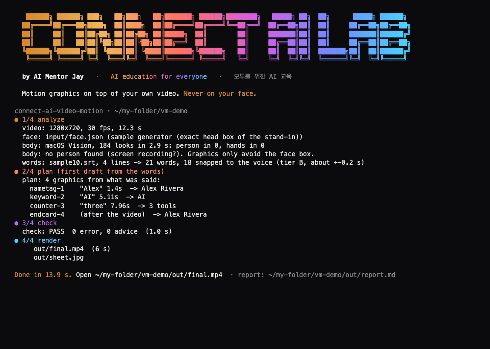

[](docs/index.html)

**[카탈로그 페이지 열기](docs/index.html)**: 그래픽 66종을 실제 영상 위 살아 있는 클립으로, 출처별로 골라 보고, 코딩 에이전트에게 줄 프롬프트를 복사합니다.

**모든 모션그래픽 생태계를 한 줄로 불러서, 내 주변 빈자리에.** Remotion 패키지, HyperFrames 블록, Lottie 파일, 내가 만든 컴포넌트가 모두 하나의 층을 지나갑니다. 이 층은 내 얼굴 · 몸 · 손이 어디 있는지 알고, 그래픽마다 좋은 빈자리를 찾고, 스스로 검사합니다.

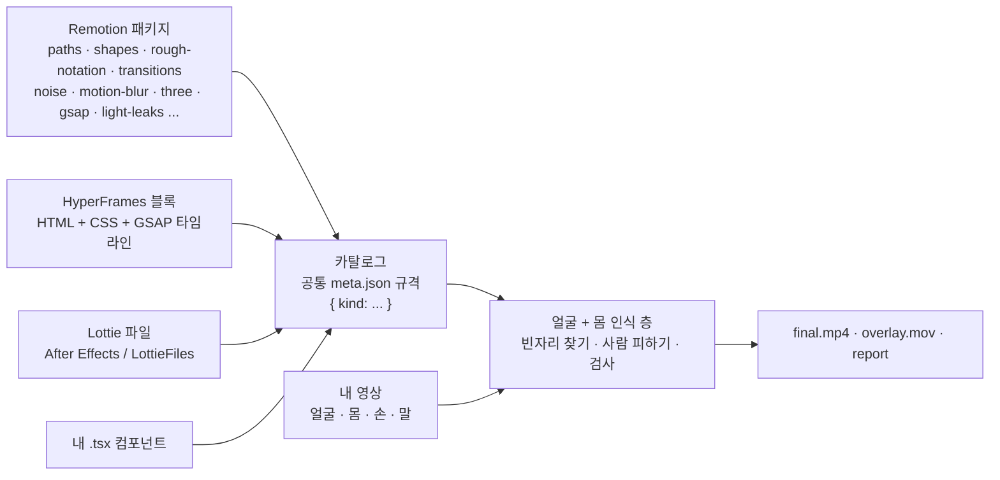

MMA 가 여러 무술의 좋은 기술을 하나로 이어 붙였듯이, 이 키트는 그래픽 라이브러리를 하나 더 만들지 않습니다. 이미 있는 것들을 이어서, 어느 것이든 `plan.json` 한 줄이 되게 합니다.

```json
{"kind": "remotion/rough-highlight", "at": {"text": "무료로", "near": 2.0}, "text": "Free"}
{"kind": "hyperframes/split-words-rise", "at": 7.6, "text": "More colorful"}
{"kind": "lottie/gold-check", "at": 9.9}
{"kind": "custom", "component": "./my/Thing.tsx", "at": 4.2, "text": "Mine"}
```

**사람 픽셀은 한 점도 바꾸지 않습니다.** 기본값은 얼굴 · 몸 · 손(1초에 15번 측정)을 피해 빈자리에 놓는 것입니다. 손을 따라다니는 그래픽, 사람 뒤에 서는 그래픽도 있지만 카탈로그의 선택지 몇 개일 뿐 기본값이 아닙니다.

> **라이선스.** 이 키트는 MIT 입니다. 바탕인 [Remotion](https://www.remotion.dev) 은 MIT 가 아닙니다. 개인, 직원 3명 이하 회사, 비영리는 무료이고 그 밖의 회사는 Remotion Company License 가 필요합니다([LICENSE.md](https://github.com/remotion-dev/remotion/blob/main/LICENSE.md)). 카탈로그 일부는 같은 Remotion License 패키지를 쓰고, HyperFrames 블록은 Apache-2.0, GSAP 는 GreenSock 의 standard no-charge license 입니다. 항목마다 `meta.json` 에 라이선스가 적혀 있고 전체 목록은 [NOTICE.md](NOTICE.md) 에 있습니다.

위 영상과 [카탈로그 페이지](docs/index.html)의 모든 클립은 만든 사람의 실제 영상입니다(방 네 곳, 빛 네 가지, 허락하에 실었습니다). 그래픽 하나가 `plan.json` 한 줄이고, 화면 글자는 그 클립에서 그가 한 말입니다(한국어, 화면은 영어). 손 위치를 손으로 적은 상자는 없습니다. 몸 인식이 찾았습니다.


<!-- gallery:start -->
## 예제 갤러리: 66개 그래픽, 하나에 plan.json 한 줄

전부 이 키트로 만든 것입니다. 영상은 만든 사람(AI 멘토 제이)의 실제 촬영본이고, 화면 글자는 그 장면에서 실제로 한 말입니다. 얼굴 픽셀은 하나도 바뀌지 않았습니다. 클립 아래가 그 클립을 만든 plan.json 한 줄입니다.

<p align="center"><br><sub>전과 후. 같은 프레임을 그래픽 없이, 그리고 plan.json 한 줄로. 글자가 사람 뒤에 섭니다(사람 매트가 앞).</sub></p>

<p align="center">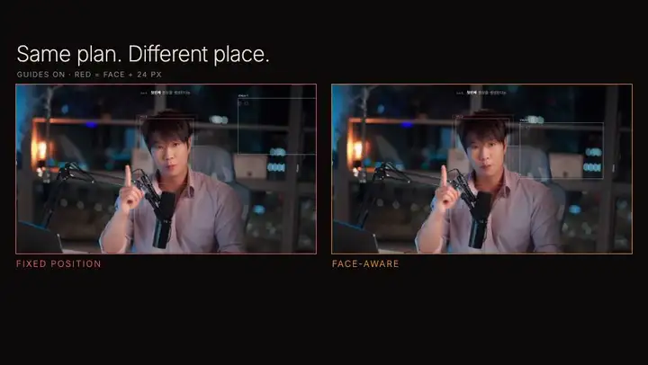<br><sub>같은 그래픽. 왼쪽은 한 자리에 고정(화면 밖으로 잘림), 오른쪽은 얼굴 기준으로 자리를 찾음.</sub></p>

### Body aware · 22

몸과 손 위치를 아는 그래픽: 손을 따라가고, 손가락을 세고, 사람 뒤에 서고, 허공에 그리고, 어깨 옆에 붙고, 내 몸을 실시간 데이터로 읽습니다. 사람 매트가 사람, 마이크, 책상을 앞에 둡니다.

<table>
<tr><td width="33%" valign="top">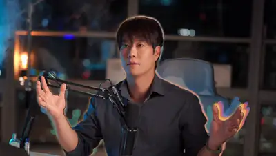<br><b>Afterimages of your motion</b><br><code>{&quot;kind&quot;: &quot;body/afterimage&quot;}</code></td><td width="33%" valign="top"><br><b>Write in the air</b><br><code>{&quot;kind&quot;: &quot;body/air-draw&quot;, &quot;text&quot;: &quot;Store it&quot;}</code></td><td width="33%" valign="top"><br><b>Aura around you</b><br><code>{&quot;kind&quot;: &quot;body/aura&quot;}</code></td></tr>
<tr><td width="33%" valign="top">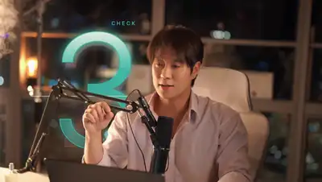<br><b>Count on the beat</b><br><code>{&quot;kind&quot;: &quot;body/beat-count&quot;, &quot;text&quot;: &quot;Right, Service, Right, Price&quot;}</code></td><td width="33%" valign="top"><br><b>Word behind you</b><br><code>{&quot;kind&quot;: &quot;body/behind-text&quot;, &quot;text&quot;: &quot;Open source&quot;, &quot;behind&quot;: true}</code></td><td width="33%" valign="top"><br><b>Line around you</b><br><code>{&quot;kind&quot;: &quot;body/contour-line&quot;, &quot;text&quot;: &quot;filmed like this&quot;}</code></td></tr>
<tr><td width="33%" valign="top">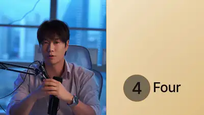<br><b>Finger count stamp</b><br><code>{&quot;kind&quot;: &quot;body/finger-count&quot;, &quot;text&quot;: &quot;One, Two, Three, Four, Five&quot;}</code></td><td width="33%" valign="top">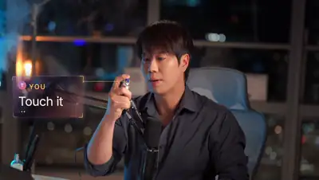<br><b>Card in your hand</b><br><code>{&quot;kind&quot;: &quot;body/grab-card&quot;, &quot;text&quot;: &quot;Touch it&quot;, &quot;sub&quot;: &quot;you&quot;}</code></td><td width="33%" valign="top"><br><b>Words circling your head</b><br><code>{&quot;kind&quot;: &quot;body/halo-words&quot;, &quot;text&quot;: &quot;Connect AI Lab&quot;}</code></td></tr>
<tr><td width="33%" valign="top"><br><b>Energy between your hands</b><br><code>{&quot;kind&quot;: &quot;body/hand-arc&quot;, &quot;text&quot;: &quot;Physical&quot;}</code></td><td width="33%" valign="top"><br><b>Robot on your hand</b><br><code>{&quot;kind&quot;: &quot;body/hand-buddy&quot;, &quot;text&quot;: &quot;Games&quot;}</code></td><td width="33%" valign="top"><br><b>Dial you turn by hand</b><br><code>{&quot;kind&quot;: &quot;body/hand-dial&quot;, &quot;text&quot;: &quot;Quality&quot;}</code></td></tr>
<tr><td width="33%" valign="top"><br><b>Chart your hand draws</b><br><code>{&quot;kind&quot;: &quot;body/hand-rise-chart&quot;, &quot;text&quot;: &quot;Hand height&quot;}</code></td><td width="33%" valign="top"><br><b>Tag on the hand</b><br><code>{&quot;kind&quot;: &quot;body/hand-tag&quot;, &quot;text&quot;: &quot;Colorful&quot;, &quot;sub&quot;: &quot;more&quot;}</code></td><td width="33%" valign="top">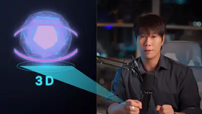<br><b>Hologram from your hand</b><br><code>{&quot;kind&quot;: &quot;body/palm-hologram&quot;, &quot;text&quot;: &quot;3D&quot;}</code></td></tr>
<tr><td width="33%" valign="top">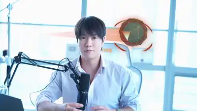<br><b>Object passes behind you</b><br><code>{&quot;kind&quot;: &quot;body/pass-behind&quot;, &quot;text&quot;: &quot;AI native&quot;}</code></td><td width="33%" valign="top">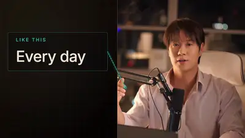<br><b>Ray from your finger</b><br><code>{&quot;kind&quot;: &quot;body/point-ray&quot;, &quot;text&quot;: &quot;Healthy food&quot;, &quot;sub&quot;: &quot;habit&quot;}</code></td><td width="33%" valign="top">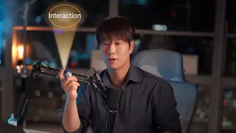<br><b>Spotlight where you point</b><br><code>{&quot;kind&quot;: &quot;body/point-spot&quot;, &quot;text&quot;: &quot;Interaction&quot;}</code></td></tr>
<tr><td width="33%" valign="top"><br><b>Room turns into data</b><br><code>{&quot;kind&quot;: &quot;body/room-to-data&quot;, &quot;text&quot;: &quot;Analyze&quot;}</code></td><td width="33%" valign="top"><br><b>Robot behind your shoulder</b><br><code>{&quot;kind&quot;: &quot;body/shoulder-buddy&quot;, &quot;text&quot;: &quot;All of it&quot;}</code></td><td width="33%" valign="top">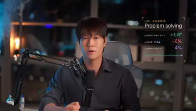<br><b>Body data beside your shoulder</b><br><code>{&quot;kind&quot;: &quot;body/shoulder-hud&quot;, &quot;text&quot;: &quot;AI agent&quot;}</code></td></tr>
<tr><td width="33%" valign="top"><br><b>Card that makes way</b><br><code>{&quot;kind&quot;: &quot;body/yield-card&quot;, &quot;text&quot;: &quot;Every day&quot;, &quot;sub&quot;: &quot;like this&quot;}</code></td></tr>
</table>

### Remotion · 39

Remotion 공식 패키지: 경로, 도형, 노이즈, three.js, GSAP, 전환, 빛 번짐, 코드로 그린 캐릭터와 수학.

<table>
<tr><td width="33%" valign="top"><br><b>Chip to card</b><br><code>{&quot;kind&quot;: &quot;remotion/animation-utils-chip&quot;, &quot;text&quot;: &quot;For beginners&quot;}</code></td><td width="33%" valign="top"><br><b>Words lit in time</b><br><code>{&quot;kind&quot;: &quot;remotion/captions-karaoke&quot;, &quot;text&quot;: &quot;Define, solve&quot;}</code></td><td width="33%" valign="top"><br><b>Letters fold up (GSAP)</b><br><code>{&quot;kind&quot;: &quot;remotion/gsap-letters&quot;, &quot;text&quot;: &quot;CONNECT AI LAB&quot;, &quot;behind&quot;: &quot;head&quot;}</code></td></tr>
<tr><td width="33%" valign="top">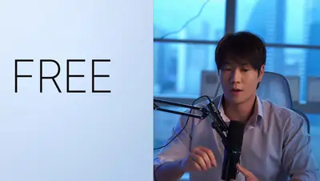<br><b>Fit-to-space word</b><br><code>{&quot;kind&quot;: &quot;remotion/layout-fit-word&quot;, &quot;text&quot;: &quot;FREE&quot;}</code></td><td width="33%" valign="top"><br><b>Light leak behind you</b><br><code>{&quot;kind&quot;: &quot;remotion/light-leaks-glow&quot;}</code></td><td width="33%" valign="top">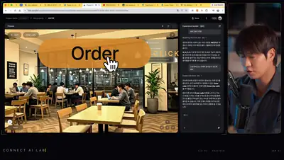<br><b>Cursor clicks a button</b><br><code>{&quot;kind&quot;: &quot;remotion/mac-cursor-click&quot;, &quot;text&quot;: &quot;Click&quot;, &quot;sub&quot;: &quot;click&quot;}</code></td></tr>
<tr><td width="33%" valign="top">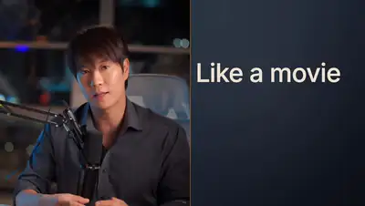<br><b>Fast word with trail</b><br><code>{&quot;kind&quot;: &quot;remotion/motion-blur-trail&quot;, &quot;text&quot;: &quot;Like a movie&quot;, &quot;behind&quot;: &quot;head&quot;}</code></td><td width="33%" valign="top"><br><b>Flow field lines</b><br><code>{&quot;kind&quot;: &quot;remotion/noise-flow-field&quot;, &quot;text&quot;: &quot;Gravity&quot;}</code></td><td width="33%" valign="top"><br><b>Jitter to clean word</b><br><code>{&quot;kind&quot;: &quot;remotion/noise-jitter-word&quot;, &quot;text&quot;: &quot;Testing&quot;}</code></td></tr>
<tr><td width="33%" valign="top"><br><b>Contour map label</b><br><code>{&quot;kind&quot;: &quot;remotion/noise-topo-label&quot;, &quot;text&quot;: &quot;Physical&quot;, &quot;sub&quot;: &quot;this world&quot;}</code></td><td width="33%" valign="top">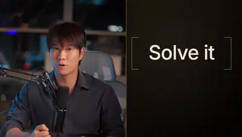<br><b>Square brackets</b><br><code>{&quot;kind&quot;: &quot;remotion/paths-brackets&quot;, &quot;text&quot;: &quot;Solve it&quot;}</code></td><td width="33%" valign="top">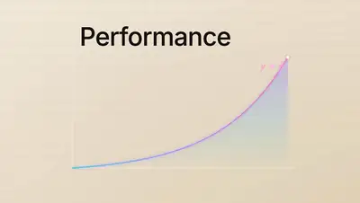<br><b>Curve draws itself</b><br><code>{&quot;kind&quot;: &quot;remotion/paths-equation-graph&quot;, &quot;text&quot;: &quot;Performance&quot;, &quot;curve&quot;: &quot;rise&quot;}</code></td></tr>
<tr><td width="33%" valign="top"><br><b>Journey A to B</b><br><code>{&quot;kind&quot;: &quot;remotion/paths-journey&quot;, &quot;text&quot;: &quot;Analyze&quot;, &quot;label&quot;: &quot;rebuild&quot;}</code></td><td width="33%" valign="top"><br><b>Shape morph, before to after</b><br><code>{&quot;kind&quot;: &quot;remotion/paths-morph&quot;, &quot;text&quot;: &quot;Engineering&quot;, &quot;sub&quot;: &quot;Business&quot;}</code></td><td width="33%" valign="top">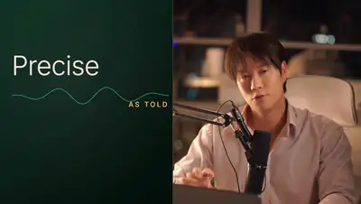<br><b>Signal wave</b><br><code>{&quot;kind&quot;: &quot;remotion/paths-signal&quot;, &quot;text&quot;: &quot;Precise&quot;, &quot;sub&quot;: &quot;as told&quot;}</code></td></tr>
<tr><td width="33%" valign="top">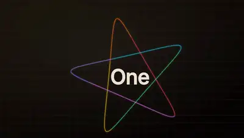<br><b>Spirograph draws itself</b><br><code>{&quot;kind&quot;: &quot;remotion/paths-spirograph&quot;, &quot;text&quot;: &quot;One&quot;}</code></td><td width="33%" valign="top"><br><b>Swoosh underline</b><br><code>{&quot;kind&quot;: &quot;remotion/paths-swoosh&quot;, &quot;text&quot;: &quot;Quality&quot;}</code></td><td width="33%" valign="top"><br><b>Pen box</b><br><code>{&quot;kind&quot;: &quot;remotion/rough-box&quot;, &quot;text&quot;: &quot;Code it&quot;}</code></td></tr>
<tr><td width="33%" valign="top"><br><b>Bracket list</b><br><code>{&quot;kind&quot;: &quot;remotion/rough-bracket-list&quot;, &quot;text&quot;: &quot;English, Japanese, German&quot;}</code></td><td width="33%" valign="top"><br><b>Highlighter</b><br><code>{&quot;kind&quot;: &quot;remotion/rough-highlight&quot;, &quot;text&quot;: &quot;Autonomous&quot;}</code></td><td width="33%" valign="top"><br><b>Strike out</b><br><code>{&quot;kind&quot;: &quot;remotion/rough-strike&quot;, &quot;text&quot;: &quot;Just tools&quot;, &quot;sub&quot;: &quot;The flow&quot;}</code></td></tr>
<tr><td width="33%" valign="top"><br><b>Message bubble</b><br><code>{&quot;kind&quot;: &quot;remotion/rounded-message&quot;, &quot;text&quot;: &quot;HyperFrames or Remotion?&quot;}</code></td><td width="33%" valign="top"><br><b>Agent robots pass the ball</b><br><code>{&quot;kind&quot;: &quot;remotion/shapes-agents&quot;, &quot;text&quot;: &quot;Teamwork&quot;}</code></td><td width="33%" valign="top"><br><b>Arrow with a word</b><br><code>{&quot;kind&quot;: &quot;remotion/shapes-arrow&quot;, &quot;text&quot;: &quot;Right target&quot;}</code></td></tr>
<tr><td width="33%" valign="top">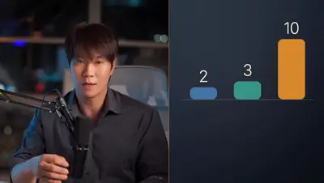<br><b>Rising bars</b><br><code>{&quot;kind&quot;: &quot;remotion/shapes-bars&quot;, &quot;value&quot;: &quot;2, 3, 10&quot;}</code></td><td width="33%" valign="top"><br><b>Speech callout</b><br><code>{&quot;kind&quot;: &quot;remotion/shapes-callout&quot;, &quot;text&quot;: &quot;Know both&quot;}</code></td><td width="33%" valign="top">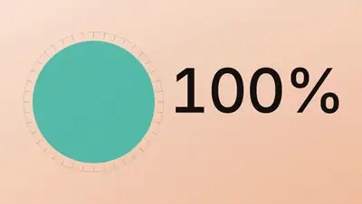<br><b>Pie to a percent</b><br><code>{&quot;kind&quot;: &quot;remotion/shapes-pie&quot;, &quot;value&quot;: &quot;100&quot;}</code></td></tr>
<tr><td width="33%" valign="top"><br><b>Hexagon badge</b><br><code>{&quot;kind&quot;: &quot;remotion/shapes-polygon-badge&quot;, &quot;text&quot;: &quot;Any format&quot;}</code></td><td width="33%" valign="top"><br><b>Star seal</b><br><code>{&quot;kind&quot;: &quot;remotion/shapes-star-seal&quot;, &quot;value&quot;: &quot;20&quot;}</code></td><td width="33%" valign="top"><br><b>Triangle marker</b><br><code>{&quot;kind&quot;: &quot;remotion/shapes-triangle-marker&quot;, &quot;text&quot;: &quot;Before we start&quot;, &quot;sub&quot;: &quot;practice&quot;}</code></td></tr>
<tr><td width="33%" valign="top"><br><b>Rays behind a number</b><br><code>{&quot;kind&quot;: &quot;remotion/starburst-rays&quot;, &quot;value&quot;: &quot;1&quot;}</code></td><td width="33%" valign="top">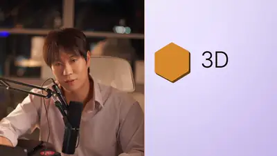<br><b>3D hex badge</b><br><code>{&quot;kind&quot;: &quot;remotion/svg3d-badge&quot;, &quot;text&quot;: &quot;3D&quot;}</code></td><td width="33%" valign="top"><br><b>3D gold coin</b><br><code>{&quot;kind&quot;: &quot;remotion/three-coin&quot;, &quot;value&quot;: &quot;66&quot;}</code></td></tr>
<tr><td width="33%" valign="top"><br><b>Clock wipe, before to after</b><br><code>{&quot;kind&quot;: &quot;remotion/transition-clock-wipe&quot;}</code></td><td width="33%" valign="top"><br><b>Card flip, before to after</b><br><code>{&quot;kind&quot;: &quot;remotion/transition-flip&quot;}</code></td><td width="33%" valign="top"><br><b>Iris, before to after</b><br><code>{&quot;kind&quot;: &quot;remotion/transition-iris&quot;}</code></td></tr>
<tr><td width="33%" valign="top"><br><b>Push cut with flash, before to after</b><br><code>{&quot;kind&quot;: &quot;remotion/transition-push-cut&quot;}</code></td><td width="33%" valign="top"><br><b>Push slide, before to after</b><br><code>{&quot;kind&quot;: &quot;remotion/transition-slide&quot;}</code></td><td width="33%" valign="top"><br><b>Diagonal wipe, before to after</b><br><code>{&quot;kind&quot;: &quot;remotion/transition-wipe&quot;}</code></td></tr>
</table>

### HyperFrames · 8

HTML + CSS + GSAP 블록.

<table>
<tr><td width="33%" valign="top"><br><b>Scramble title (GSAP)</b><br><code>{&quot;kind&quot;: &quot;hyperframes/gold-scramble-title&quot;, &quot;text&quot;: &quot;Motion&quot;, &quot;sub&quot;: &quot;graphics&quot;}</code></td><td width="33%" valign="top">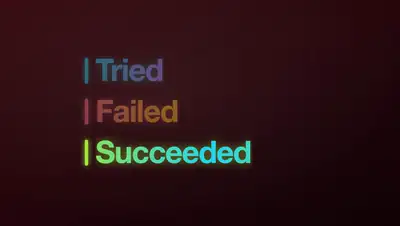<br><b>Neon word stack (GSAP)</b><br><code>{&quot;kind&quot;: &quot;hyperframes/neon-stack&quot;, &quot;text&quot;: &quot;Tried&quot;, &quot;label&quot;: &quot;Succeeded&quot;}</code></td><td width="33%" valign="top"><br><b>Ring counter (GSAP)</b><br><code>{&quot;kind&quot;: &quot;hyperframes/ring-count&quot;, &quot;value&quot;: &quot;8&quot;}</code></td></tr>
<tr><td width="33%" valign="top"><br><b>Words rise (GSAP SplitText)</b><br><code>{&quot;kind&quot;: &quot;hyperframes/split-words-rise&quot;, &quot;text&quot;: &quot;My AI agents&quot;}</code></td><td width="33%" valign="top"><br><b>Circle stat (HyperFrames)</b><br><code>{&quot;kind&quot;: &quot;hyperframes/warm-grain-circle-stat&quot;, &quot;text&quot;: &quot;wake up&quot;, &quot;value&quot;: &quot;8 AM&quot;}</code></td><td width="33%" valign="top"><br><b>Pill stat (HyperFrames)</b><br><code>{&quot;kind&quot;: &quot;hyperframes/warm-grain-pill-stat&quot;, &quot;value&quot;: &quot;Opportunity&quot;}</code></td></tr>
<tr><td width="33%" valign="top"><br><b>Shape label (HyperFrames)</b><br><code>{&quot;kind&quot;: &quot;hyperframes/warm-grain-shape-label&quot;, &quot;text&quot;: &quot;Mix them&quot;}</code></td><td width="33%" valign="top"><br><b>Title card (HyperFrames)</b><br><code>{&quot;kind&quot;: &quot;hyperframes/warm-grain-title-card&quot;, &quot;text&quot;: &quot;AI education&quot;, &quot;sub&quot;: &quot;for everyone&quot;}</code></td></tr>
</table>

### Lottie · 4

After Effects · LottieFiles 애니메이션, 캐릭터도.

<table>
<tr><td width="33%" valign="top"><br><b>Orbit arcs (Lottie)</b><br><code>{&quot;kind&quot;: &quot;lottie/arc-orbit&quot;}</code></td><td width="33%" valign="top"><br><b>Check mark (Lottie)</b><br><code>{&quot;kind&quot;: &quot;lottie/gold-check&quot;}</code></td><td width="33%" valign="top"><br><b>Hopping character (Lottie)</b><br><code>{&quot;kind&quot;: &quot;lottie/hop-buddy&quot;}</code></td></tr>
<tr><td width="33%" valign="top"><br><b>Signal pulse (Lottie)</b><br><code>{&quot;kind&quot;: &quot;lottie/signal-pulse&quot;}</code></td></tr>
</table>

### Kit · 7

키트 기본 그래픽.

<table>
<tr><td width="33%" valign="top"><br><b>Screen card + arrow</b><br><code>{&quot;kind&quot;: &quot;kit/card&quot;, &quot;text&quot;: &quot;To-do list&quot;}</code></td><td width="33%" valign="top"><br><b>Chapter line</b><br><code>{&quot;kind&quot;: &quot;kit/chapter&quot;, &quot;text&quot;: &quot;Follow along&quot;, &quot;value&quot;: &quot;02&quot;}</code></td><td width="33%" valign="top"><br><b>Number counter</b><br><code>{&quot;kind&quot;: &quot;kit/counter&quot;, &quot;value&quot;: &quot;5&quot;}</code></td></tr>
<tr><td width="33%" valign="top"><br><b>End card</b><br><code>{&quot;kind&quot;: &quot;kit/endcard&quot;, &quot;text&quot;: &quot;CONNECT AI LAB&quot;, &quot;sub&quot;: &quot;AI education for everyone&quot;}</code></td><td width="33%" valign="top"><br><b>Key word</b><br><code>{&quot;kind&quot;: &quot;kit/keyword&quot;, &quot;text&quot;: &quot;Visual Vibe Coding&quot;, &quot;behind&quot;: &quot;head&quot;}</code></td><td width="33%" valign="top"><br><b>Name tag</b><br><code>{&quot;kind&quot;: &quot;kit/nametag&quot;, &quot;text&quot;: &quot;AI Mentor Jay&quot;, &quot;sub&quot;: &quot;CONNECT AI LAB&quot;}</code></td></tr>
<tr><td width="33%" valign="top"><br><b>1 · 2 · 3 steps</b><br><code>{&quot;kind&quot;: &quot;kit/steps&quot;, &quot;text&quot;: &quot;Film&quot;, &quot;value&quot;: &quot;1&quot;}</code></td></tr>
</table>

<!-- gallery:end -->

## 보기

| | 파일 | 볼 것 |
|---|---|---|
| 카탈로그 페이지 | [docs/index.html](docs/index.html) | 그래픽 66종, 하나에 살아 있는 클립 하나, `kind` · 라이선스 · 복사할 프롬프트 |
| 릴 | [docs/hero_v2.mp4](docs/hero_v2.mp4) | 맨 위 영상의 1920x1080 버전(소리 있는 버전: [docs/hero_v2_social.mp4](docs/hero_v2_social.mp4)) |
| 시트 | [docs/sheet.jpg](docs/sheet.jpg) | 그래픽마다 정점의 정지 화면 하나 |
| 몸 | [docs/body_sheet.jpg](docs/body_sheet.jpg) | 몸 인식이 보는 것: 사람 영역, 관절, 손, 손가락 수 |

## 해 보기

Node.js 18 이상만 있으면 됩니다. Python 은 필요 없고 ffmpeg 는 Remotion 안에 든 것을 씁니다.

```bash
git clone https://github.com/wonseokjung/connect-ai-video-motion.git
cd connect-ai-video-motion
npm install
npx github:wonseokjung/connect-ai-video-motion demo           # 들어 있는 샘플로 처음부터 끝까지
npx github:wonseokjung/connect-ai-video-motion catalog        # 부를 수 있는 그래픽 전부, 출처별
npx github:wonseokjung/connect-ai-video-motion gallery vm-demo --sheet
```

내 영상: `npx github:wonseokjung/connect-ai-video-motion my-talk.mp4`. 코딩 에이전트(Claude Code, Codex, Antigravity)로 하려면 `npx github:wonseokjung/connect-ai-video-motion install-skill` 한 뒤 "내 영상에 모션그래픽 얹어 줘" 라고 하면 됩니다.

## 어떻게 놓는가

1. **얼굴.** Mac 에서는 macOS Vision. Windows · Linux(또는 Xcode 도구가 없는 Mac)에서는 MediaPipe 얼굴 인식이 자동으로 찾습니다. 키트에 들어 있어 따로 받을 것이 없습니다. 얼굴을 못 찾으면 `face-sheet.jpg` 를 보고 사람이나 에이전트가 얼굴 상자를 적습니다.
2. **몸과 손.** macOS Vision 이 몸 관절(최대 19개), 손마다 21점, 사람 영역(64×36 격자)을 1초에 15번 찾고, 그래픽이 사람 뒤로 가는 구간에는 사람 매트도 만듭니다. Windows · Linux 에서는 MediaPipe 가 같은 일을 합니다(아래). 둘 다 없으면 0.1 처럼 얼굴 상자에서 몸을 짐작합니다.
3. **빈자리.** 보호 영역 = 얼굴 + 측정한 사람(팔 · 손 포함) + 여백, 그래픽이 떠 있는 시간 전체에 걸쳐서. 이름 붙은 자리(옆, 아래 띠, 위)를 먼저 보고 없으면 빈 곳 전체에서 찾습니다. 크게 움직여서 한 자리가 끝까지 비지 않으면 반으로 나눠 한 자리에서 다음 자리로 페이드합니다. 그래도 없으면 숨기고 리포트에 이유를 씁니다.
4. **말.** `plan.json` 은 "한 말 → 그래픽" 표입니다. 단어 시간이 있으면 단어 뒤 40 ms, 문장 자막이면 ±0.2 s 에 뜹니다.
5. **검사.** `check` 가 문제를 문장으로 씁니다: 얼굴을 가림, 사람(몸 · 팔 · 손, 측정값)을 가림, 다른 그래픽 위에 겹침, 화면 밖, 4단어 넘음, 대비 부족, 손가락 광선이 얼굴을 지남, 몸 윤곽선이 몸에 닿음, 같은 디자인 두 번.

## 카탈로그

`npx github:wonseokjung/connect-ai-video-motion catalog` 이 전부 보여 줍니다. 지금 **재생되는 그래픽 66개**, 그리고 아직 안 되는 4개는 이유와 함께 목록에 있습니다.

| 출처 | 수 | 예 |
|---|---|---|
| `kit/` | 7 | 이름표, 핵심 단어, 숫자 카운터, 1 · 2 · 3 단계, 화면 카드, 챕터, 엔드카드 |
| `remotion/` | 39 | 공을 주고받는 로봇 캐릭터(shapes + spring), 스스로 그려지는 곡선, 스피로그래프, 노이즈 흐름선, rough-notation 박스 · 형광펜 · 취소선 · 괄호 목록, paths 여정 · 모핑 · 신호 · 밑줄, shapes 파이 · 막대 · 말풍선 · 별 도장 · 육각 배지, transitions 시계 와이프 · 아이리스 · 뒤집기 · 밀기 · 대각 와이프 · 푸시 컷, noise 흔들림 · 등고선, motion-blur 잔상, starburst 빛살, 사람 뒤 라이트 릭, 3D 육각 배지(svg-3d-engine), 3D 금화(three), GSAP 글자, macOS 커서 클릭, 말에 맞춰 켜지는 단어(captions) |
| `hyperframes/` | 8 | warm-grain 원 숫자 · 알약 숫자 · 도형 라벨 · 제목 카드, 스크램블 제목 · 단어 솟음 · 링 카운터 · 네온 단어 스택(HyperFrames 형식으로 만든 우리 블록) |
| `lottie/` | 4 | 통통 뛰는 캐릭터, 체크, 신호 펄스, 궤도 호 |
| `body/` | 8 | 사람 뒤 글자, 몸 윤곽선, 손 옆 태그, 손가락 수 도장, 손가락 광선, 손 옆 3D 홀로그램, 손을 따라다니는 로봇, 손 높이 실시간 차트 |

항목 하나 = 폴더 `catalog/<출처>/<이름>/` (컴포넌트 또는 `block.html` / `anim.json`) + `meta.json`:

```json
{
  "kind": "remotion/shapes-pie",
  "title": "Pie to a percent",
  "description": "A pie fills to the percent you said, the number counts with it.",
  "source": {"type": "remotion", "package": "@remotion/shapes", "version": "4.0.529"},
  "license": "MIT",
  "use": "number",
  "props": {"value": "percent 0-100", "text": "what it is (1-3 words)"},
  "place": "box",
  "size": {"aspect": 2.2, "minW": 0.22, "maxW": 0.34},
  "dur": 2.8,
  "family": "pie"
}
```

plan 한 줄에 `"scale": 1.3`(이 그래픽만 30 % 크게. 자리가 없으면 평소처럼 한 단계씩 줄어듭니다), `"slot": "beside-right"`(이쪽부터 시도), `"behind": true` 또는 `"head"`(글자를 내 뒤에 크게: 사람 매트 아래에 그리고, 낱말 경계에서 갈라 내 양옆에 놓아서 머리가 글자를 가리지 않습니다. 25 % 넘게 가리면 `check` 가 오류를 냅니다), `"side": "minutes"`(그래픽 반대편에 같은 높이로 놓는 큰 낱말 하나: 왼쪽 숫자, 오른쪽 낱말)를 적을 수 있고, `kit/keyword` 는 글자에 줄바꿈(`"Visual\nVibe Coding"`)을 넣으면 낱말을 쌓고 마지막 줄을 골드로 씁니다. `my-info.json` 의 `"style"` 로 분위기를 고릅니다: `connect`(검정 × 골드, 기본), `day`(밝은 방용 같은 분위기: 어두운 글자), `night`, `clean`.

`place` 는 층이 어떻게 다룰지입니다: `box`(옆 빈자리), `attach`(`hand`, `fingers`, `point`, `contour`: 몸을 따라감, 손이 잘 안 보이면 숨김), `behind`(사람 뒤, 사람 매트 아래), `edge`, `post`, `full`. `family` 는 디자인 이름이라 한 영상에 두 번 쓰면 경고가 나옵니다.

### 내 그래픽

| 가진 것 | plan.json 한 줄 |
|---|---|
| Remotion 컴포넌트 | `{"kind": "custom", "component": "./my/Thing.tsx", "at": 4.2, "meta": {"size": {"aspect": 2, "maxW": 0.3}}}` |
| HyperFrames 블록 | `{"kind": "hyperframes", "src": "./block.html", "at": 6, "meta": {"window": [0, 3], "text": {".title": "text"}}, "text": "Hello"}` |
| Lottie 파일 | `{"kind": "lottie", "src": "./anim.json", "at": 8}` |

컴포넌트는 `{it, r, lf, dur, st, ink, u, fps, L, mainF}` 를 받습니다: plan 한 줄, 자기 상자 `[x, y, w, h]`, 그래픽 안 프레임 등(`src/catalog/ui.tsx`). `r` 밖으로 나가면 안 됩니다.

### HyperFrames

어댑터가 블록(HTML + CSS + `window.__timelines` 의 멈춘 GSAP 타임라인)을 투명 iframe 안에서 돌리고 Remotion 프레임마다 그 시간으로 맞춥니다. GSAP 와 플러그인은 CDN 이 아니라 설치된 `gsap` 패키지에서 가져옵니다. `Math.random` 은 씨앗을 고정하고 CSS 애니메이션도 프레임 시간에 붙잡아 두어, 몇 번을 렌더해도 같은 그림이 나옵니다. `meta.window` 는 블록 타임라인의 몇 초를 쓸지, `meta.crop` 은 캔버스의 어느 부분을, `meta.text` 는 내 말을 어디에 넣을지입니다.

```bash
npx github:wonseokjung/connect-ai-video-motion hf-import <폴더>   # 레지스트리, 템플릿, 내 .html 파일
```

블록마다 검사합니다. WebGL · canvas, 자체 영상 · 소리, `requestAnimationFrame` 루프, 인터넷에서 가져오는 스크립트, 템플릿 자리표시자, 타임라인 없음은 `unsupported` 와 이유로 목록에 남습니다.

## Windows · Linux 에서 얼굴 · 몸 인식

얼굴은 어느 컴퓨터에서나 바로 됩니다. `@mediapipe/tasks-vision` 이 의존성으로 함께 설치되고, 얼굴 모델(`models/mediapipe/blaze_face_short_range.tflite`, 230 KB, Google, Apache-2.0)이 키트에 들어 있습니다. 시험 영상(3840x2160, 23번 비교)에서 머리 상자가 macOS Vision 상자와 중앙값 37 px 안쪽으로 맞았습니다. Mac 에서도 `VM_FACE=mediapipe` 로 돌려 볼 수 있습니다. `--verbose`(또는 `VM_VERBOSE=1`)를 붙이면 얼굴 탐지기가 본 내용을 한 장씩 출력합니다.

macOS 몸 인식은 따로 받을 것이 없습니다. 다른 컴퓨터에서는 MediaPipe 어댑터(`lib/adapters/mediapipe-body.mjs`)가 Remotion 의 Chrome 안에서 MediaPipe Pose + Hands 를 돌립니다. 패키지는 키트와 함께 설치되고, 몸 모델 두 개는 따로 받아야 합니다(Google, Apache-2.0):

| 무엇 | 넣을 곳 |
|---|---|
| `pose_landmarker_lite.task` | `models/mediapipe/` |
| `hand_landmarker.task` | `models/mediapipe/` |

받는 주소는 `lib/adapters/mediapipe-body.mjs` 맨 위에 있습니다. 파일이 있으면 `analyze` 가 알아서 MediaPipe 를 쓰고, 없으면 어느 파일이 없는지 말합니다. 사람 매트는 만들지 않아 사람 뒤 그래픽은 숨겨집니다. 이 어댑터는 tasks-vision 공식 API 대로 썼지만 Windows 에서 아직 시험하지 않았습니다. 보이는 그대로 이슈로 알려 주세요.

## 결과물

`out/final.mp4` · `out/short_9x16.mp4`(`--short`) · `out/overlay.mov`(`--overlay`, 알파 있는 ProRes 4444, Premiere / CapCut / DaVinci 용) · `out/sheet.jpg`(그래픽마다 등장 / 정점 / 퇴장, 측정한 사람 표시) · `out/report.md` · `out/gallery.mp4`, `out/gallery_sheet.jpg`(`gallery`) · `out/body-sheet.jpg`(`body-sheet`).

## 아직

HyperFrames 레지스트리 전체(456개)는 패키지에 없습니다. 받아서 `hf-import` 하면 됩니다. `@remotion/transitions` 의 셰이더 전환(book flip, crosswarp, ripple ...)은 실험 기능인 HTML-in-canvas 가 켜진 브라우저가 필요해서 unsupported 로 적어 두었습니다. 효과음과 자동 단어 시간(whisper)은 이번 버전에 없습니다.

## 출처

오픈소스 부품으로 만들었고 패키지 · 버전 · 라이선스를 [NOTICE.md](NOTICE.md) 에 하나씩 적었습니다. npm 패키지 안의 샘플 영상은 코드로 그린 대역과 합성 목소리입니다. `docs/` 의 클립에는 만든 사람이 허락하에 나옵니다. `tools/make-showcase.mjs` 와 `tools/make-docs.mjs` 로 만들었습니다.

MIT · CONNECT AI LAB
