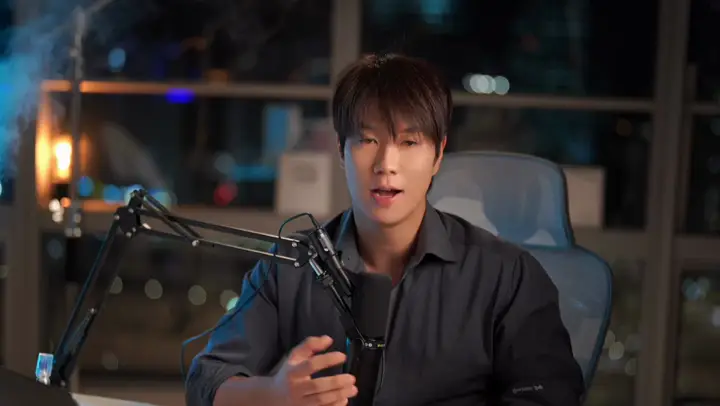
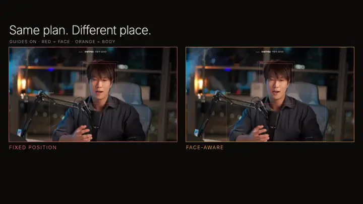
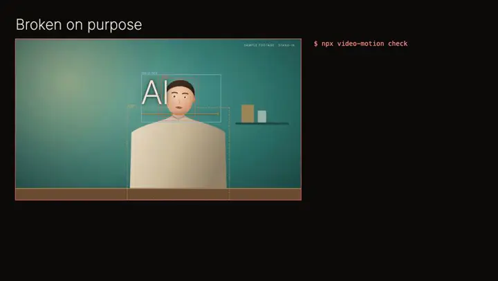

# video-motion

**얼굴 필터가 아닙니다.** 내 모습의 픽셀은 한 점도 바꾸지 않고, 얼굴과 몸 위에는 아무것도 올리지 않습니다. 내가 찍은 말하는 영상에서 내 **옆**의 빈 곳에 코드로 만든 모션그래픽을 얹습니다.

내가 말하면 키트가 얼굴이 어디 있는지와 무슨 말을 했는지 읽고, 그 말에 맞는 그래픽(이름표, 핵심 낱말, 올라가는 숫자, 1 · 2 · 3 단계, 화살표가 달린 화면 카드, 챕터 줄, 엔드카드)을 내 옆에 놓습니다. 그리고 스스로 검사해서 무엇이 잘못됐는지 문장으로 알려 줍니다.

> **Remotion 라이선스.** 이 키트는 MIT 지만, 돌아가는 엔진인 [Remotion](https://www.remotion.dev) 은 MIT 가 아닙니다. 개인, 직원 3명 이하 회사, 비영리는 무료이고, 그 밖의 회사는 Remotion 회사 라이선스가 필요합니다. 회사에서 쓰기 전에 [Remotion LICENSE.md](https://github.com/remotion-dev/remotion/blob/main/LICENSE.md) 를 읽어 주세요.



만든 사람이 직접 찍은 12초 영상입니다. 그가 한 말에서 핵심 낱말 두 개와 챕터 줄을 뽑아 옆에 놓았고, 얼굴, 몸, 손 자리는 비웠습니다. [mp4](docs/demo/demo_a.mp4)

## 먼저 보기

| | 데모 | 볼 곳 |
|---|---|---|
| A | [demo_a.mp4](docs/demo/demo_a.mp4) | 실제 영상에 얹은 완성본(위) |
| B | [demo_b.mp4](docs/demo/demo_b.mp4) | 왼쪽: 같은 그래픽을 템플릿처럼 한 자리에 고정해서 화면 밖으로 나감. 오른쪽: 얼굴 기준으로 배치 |
| C | [demo_c.mp4](docs/demo/demo_c.mp4) | 일부러 얼굴을 가리는 plan(그림 대역) → `check` 가 실제 메시지로 잡음 → 고침 → `PASS` |
| 9:16 | [demo_916.mp4](docs/demo/demo_916.mp4) | plan 하나로 16:9 와 9:16 을 동시에(그림 대역) |

<p> </p>

데모 영상은 이 저장소의 `docs/demo/` 에만 있고 npm 패키지에는 들어가지 않습니다.

## 30초 만에 해 보기

Node.js 18 이상과 git 만 있으면 됩니다. 파이썬은 필요 없고, ffmpeg 는 Remotion 안에 든 것을 씁니다.

GitHub 에서 바로:

```bash
npx github:wonseokjung/video-motion demo
```

또는 내려받아서:

```bash
git clone https://github.com/wonseokjung/video-motion.git
cd video-motion
npm install
npx video-motion demo     # 내장 12초 샘플(그림으로 그린 대역 + 합성 목소리)을 처음부터 끝까지
```

`vm-demo/out/final.mp4`, 스틸 시트(`sheet.jpg`), 보고서(`report.md`)가 생깁니다.
안 되면 `npx video-motion doctor` 로 컴퓨터를 점검합니다.

## 내 영상으로

코딩 에이전트(Claude Code, Codex, Antigravity)와 함께 하는 것이 가장 쉽습니다.

```bash
npx video-motion install-skill   # 에이전트에 스킬 추가
```

에이전트에게 "내 영상에 모션그래픽 얹어 줘" 라고 하고 파일을 주면, 스킬이 아래 단계를 돌리고 `check` 가 통과할 때까지 plan 을 고칩니다.

영상 파일 하나로 한 줄에:

```bash
npx video-motion my-talk.mp4      # 옆에 my-talk-video-motion/ 폴더를 만들고 전부 돌림
```

직접 할 때:

1. 폴더를 만들고 영상을 `<폴더>/input/` 에 넣습니다. 자막(YouTube, CapCut, Premiere 의 `.srt` / `.vtt`)이 있으면 옆에 둡니다.
2. `my-info.json` 을 폴더에 복사해 이름, 하는 일, 스타일(`connect`, `night`, `clean`), 엔드카드 문구를 씁니다.
3. `npx video-motion run <폴더>`. 9:16 판은 `--short`, 투명 `overlay.mov`(Premiere, CapCut, DaVinci 용)는 `--overlay`.
4. `out/report.md` 를 읽고 `plan.json` 을 고친 뒤 다시 돌립니다. 그래픽 하나만 다시 뽑을 때는 `--only <id>`.

## 어떻게 돌아가나

**1. 얼굴을 안다.** 맥에서는 macOS Vision 으로 얼굴을 찾습니다(Xcode 명령줄 도구 필요, 내려받을 것 없음). 다른 컴퓨터에서는 `face-sheet.jpg` 를 보고 나나 에이전트가 얼굴 상자를 적습니다. 선택: 어느 컴퓨터에서나 도는 pico 얼굴 찾기는 240 KB 모델 파일(`models/facefinder`, MIT)이 필요하고 아직 함께 넣지 않았습니다. 모든 그래픽은 찾아낸 얼굴 상자 + 24 px 밖, 옆으로는 얼굴 폭의 0.3배 이상 떨어뜨려 둡니다. 그래픽은 떠 있는 동안 한 자리에 있고, 내가 크게 움직일 때만 한 번 옮깁니다. 옆자리가 좁으면 작게 줄이지 않고 아래 띠나 위 띠로 갑니다. 얼굴을 확실히 못 찾은 구간에서는 그래픽을 숨기고 보고서에 적습니다. 몸도 비웁니다. 얼굴 상자에서 어깨와 몸통을 어림합니다(얼굴 폭의 3배 너비, 어깨선부터 화면 아래 끝까지). `my-info.json` 이나 `plan.json` 의 `"body": {"width": 3, "top": 0.75}` 로 바꾸고, `"body": false` 로 끕니다. 9:16 에서는 몸이 화면 폭을 다 채우므로 몸 영역을 윗가슴까지만 잡고(`tallDepth`, 얼굴 높이의 0.55배) 그 아래 가슴 띠는 쓸 수 있게 둡니다. 손이나 마이크 암은 찾지 못하므로 `plan.protect` 에 적어 두면 그곳을 비웁니다.

**2. 말을 안다.** `plan.json` 은 "말한 낱말 → 그래픽" 표입니다. 첫 판은 내 말에서 자동으로 씁니다. 이름을 말하면 이름표, "첫째 / 둘째 / 셋째" 는 단계, 숫자는 카운터, "다음으로 …" 는 챕터. 그래픽은 그 낱말 뒤 0–80 ms 에 들어옵니다. 시간이 어디서 왔는지는 정직하게 밝힙니다.

| 등급 | 가진 것 | 정확도 |
|---|---|---|
| A | 낱말 시간(`<이름>.words.json`) | 낱말 그대로 |
| B | 문장 자막(`.srt` / `.vtt`) | 문장 안에 낱말을 나눈 뒤 목소리에 맞춤, 약 ±0.2초 |
| C | 없음 | 손으로 쓴 시간 |

한 줄은 이렇게 낱말을 가리켜서, 자막을 조금 고쳐도 살아남습니다.

```json
{"id": "counter-3", "kind": "counter", "at": {"text": "three", "near": 7.9}, "value": "3", "unit": "tools"}
```

**3. 스스로 검사한다.** `check` 는 까다로운 편집자처럼 plan 을 재고, 문제마다 무엇이, 언제, 어떻게 고치는지를 문장으로 씁니다.

- 오류(꼭 고침): 얼굴을 가림, 몸을 가림, 화면 밖, 4낱말 넘음, 글자 대비 부족, `plan.protect` 자리를 가림, 화살표가 얼굴을 지남, 말하지 않은 낱말을 가리킴.
- 조언(내 판단): 같은 종류 두 번(1 · 2 · 3 묶음은 한 번), 3초 넘게 변화 없음, 그래픽이 너무 작음, 자리가 없어 숨김.

대비는 그래픽 밑의 실제 영상 밝기로 잽니다. 밝은 곳이면 글자 둘레에 4.5:1 이 될 만큼만 옅은 그림자를 둡니다. 9:16 에서는 앱 화면 영역(위 막대, 옆 버튼, 자막 자리)을 비웁니다.

## 그래픽 7종, 스타일 3종

| 종류 | 움직임 |
|---|---|
| `nametag` | 강조 막대가 자라고, 이름이 밀려 올라오며 스크램블이 풀리고, 선이 그려지고, 하는 일이 미끄러져 들어옴 |
| `keyword` | 글자가 하나씩 솟고, 빛이 한 번 훑고, 끝 눈금이 달린 가는 선 |
| `counter` | 숫자 띠가 모션블러와 함께 구르고, 눈금자가 차고, 단위가 눈금자 위에 |
| `steps` | 진행 점, 숫자가 초점이 맞으며 나타나고, 단계 글자가 미끄러져 나옴 |
| `card` | 화면을 확대한 카드가 펼쳐지고, 화살표가 그려지고, 손그림 원이 대상을 감쌈 |
| `chapter` | 선이 그려지고, 챕터 번호가 내려앉고, 제목이 선 위로 솟음 |
| `endcard` | 영상 뒤에: 이름이 낱말씩, 선, 행동 문구 |

스타일: `connect`(검정과 금색, 얇은 글자), `night`(틸), `clean`(파랑, 흰 카드). 강조색은 하나, 선과 숫자에만. 박스 테두리, 파티클, 이모지는 없습니다.

## 결과물

`out/final.mp4`(기본) · `out/short_9x16.mp4`(`--short`) · `out/overlay.mov`(`--overlay`, 알파가 있는 ProRes 4444) · `out/sheet.jpg`(모든 그래픽의 들어옴 / 정점 / 나감, 얼굴 상자 빨강, 몸 상자 주황, 그래픽 상자 파랑) · `out/report.md`.

## 무엇이고 무엇이 아닌가

[ossclip](https://github.com/AhsanAyaz/ossclip) 은 이미 얼굴 찾기 + 낱말 시간 + 코드 그래픽을 하고, 우리도 거기서 배웠습니다. 이 키트가 더하려는 것은, 코딩을 모르는 사람이 샘플에서 내 영상, 수정까지 따라갈 수 있는 길과, 실패마다 이유를 문장으로 알려 주어 에이전트(또는 내)가 고칠 수 있게 하는 검사 고리입니다.

## 아직 (로드맵)

사람 뒤로 지나가는 글자, 효과음, 더 많은 그래픽 종류, 같은 `plan.json` 을 HyperFrames 로 그리는 길, 자동 낱말 시간(whisper), 어느 컴퓨터에서나 도는 얼굴 찾기(pico 또는 MediaPipe). 모두 모델을 내려받아야 해서 이번 판에는 넣지 않았습니다.

## 출처

열린 소스 부품으로 만들었고, 부품마다 저장소 · 커밋 · 라이선스를 [NOTICE.md](NOTICE.md) 에 적었습니다. 패키지 안의 샘플 영상은 그림으로 그린 대역이고 목소리는 합성입니다. npm 패키지에는 실제 사람이 들어 있지 않습니다. `docs/demo/` 의 데모 A, B 에는 만든 사람이 본인 허락 아래 나옵니다.

MIT · CONNECT AI LAB
