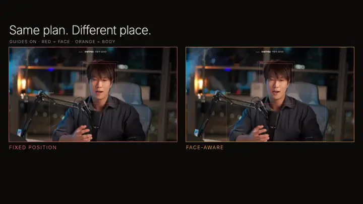
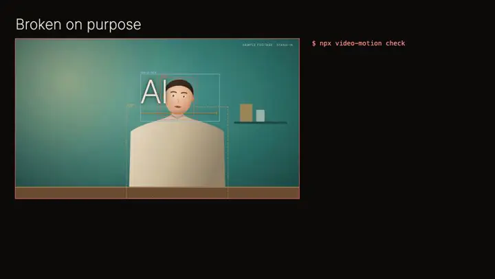

# connect-ai-video-motion

**Not a face filter.** It never changes a single pixel of you and never puts anything on your face or body. It puts code-made motion graphics in the empty space *next to* you in your own talking-head video.

You talk. The kit reads where your face is and what you said, puts the matching graphic beside you (a name tag, a key word, a number that counts up, 1 · 2 · 3 steps, a screen card with an arrow, a chapter line, an end card), and then checks its own work and tells you in plain sentences what is wrong.

> **Remotion licence.** This kit is MIT, but it runs on [Remotion](https://www.remotion.dev), which is not MIT. Remotion is free for individuals, companies with up to 3 employees and non-profits; other companies need a Remotion Company License. Read [Remotion's LICENSE.md](https://github.com/remotion-dev/remotion/blob/main/LICENSE.md) before you use this at work.


The author's own 12 s clip: two key words and a chapter line, placed beside him from the words he said, face, body and hands left clear. [mp4](docs/demo/demo_a.mp4)

## See it

| | Demo | What to look at |
|---|---|---|
| A | [demo_a.mp4](docs/demo/demo_a.mp4) | The finished result on a real video (above). |
| B | [demo_b.mp4](docs/demo/demo_b.mp4) | Left: the same graphics nailed to one spot, like a template, so they run off the frame. Right: placed by the face. |
| C | [demo_c.mp4](docs/demo/demo_c.mp4) | A plan that covers the face on purpose (drawn stand-in). `check` catches it with its real message, the plan is fixed, `PASS`. |
| 9:16 | [demo_916.mp4](docs/demo/demo_916.mp4) | One plan, rendered as 16:9 and 9:16 at the same time (drawn stand-in). |

<p> </p>

The demo videos live in `docs/demo/` in this repository only; they are not part of the npm package.

## Try it in 30 seconds

You need Node.js 18 or newer and git. Nothing else: the kit uses the ffmpeg that comes inside Remotion, no Python.

Straight from GitHub:

```bash
npx github:wonseokjung/connect-ai-video-motion demo
```

Or clone it:

```bash
git clone https://github.com/wonseokjung/connect-ai-video-motion.git
cd connect-ai-video-motion
npm install
npx connect-ai-video-motion demo     # built-in 12 s sample (a drawn stand-in, synthetic voice), start to finish
```

It writes `vm-demo/out/final.mp4`, a still sheet (`sheet.jpg`) and a report (`report.md`).
`npx connect-ai-video-motion doctor` checks your computer if something does not run.

## Your own video

The easy way is with a coding agent (Claude Code, Codex, Antigravity):

```bash
npx connect-ai-video-motion install-skill   # adds the skill to your agents
```

Then tell your agent: "put motion graphics on my video" and give it the file. The skill runs the steps below and fixes the plan until `check` passes.

Or in one line, with any video file:

```bash
npx connect-ai-video-motion my-talk.mp4      # makes my-talk-video-motion/ next to it and runs everything
```

By hand:

1. Make a folder, put your video in `<folder>/input/`. If you have subtitles (`.srt` / `.vtt` from YouTube, CapCut, Premiere), put them next to it.
2. Copy `my-info.json` into the folder and fill in your name, what you do, a style (`connect`, `night`, `clean`) and your end card line.
3. `npx connect-ai-video-motion run <folder>`, add `--short` for a 9:16 version and `--overlay` for a transparent `overlay.mov` (Premiere, CapCut, DaVinci).
4. Read `out/report.md`. Change `plan.json`, run again. `--only <id>` re-renders one graphic.

## How it works

**1. Face-aware.** It finds your face with macOS Vision on a Mac (needs the Xcode command line tools, nothing to download). On other computers you or your agent write the face box by looking at `face-sheet.jpg`. Optional: a pico face detector for every computer, which needs a 240 KB model file (`models/facefinder`, MIT) that is not shipped yet. Every graphic stays out of the detected face box plus 24 px, and at least 0.3 face widths away from it at the sides. A graphic keeps one place while it is on screen and moves once only if you move a lot. If the side next to you is too narrow it goes to the lower band or the top banner instead of getting tiny. Where detection is unsure, the graphic is hidden and the report says so. The body is kept clear too: from the face box the kit estimates the shoulders and torso (3 face widths wide, from the shoulder line down to the bottom of the frame). Change it with `"body": {"width": 3, "top": 0.75}` in `my-info.json` or `plan.json`, or turn it off with `"body": false`. In 9:16 the body fills the whole width, so there the body area stops after the upper chest (`tallDepth`, 0.55 face heights) and the lower chest band may be used. Hands and things like a microphone arm are not detected: mark them in `plan.protect` and nothing will be put there.

**2. Speech-aware.** `plan.json` is a table of "said word → graphic". The first draft is written from your words: your name gives a name tag, "first / second / third" gives steps, a number gives a counter, "next ..." gives a chapter. A graphic lands 0–80 ms after its word. The timing is honest about where it came from:

| Tier | You have | How exact |
|---|---|---|
| A | word times (`<name>.words.json`) | the word itself |
| B | sentence subtitles (`.srt` / `.vtt`) | words spread over the sentence, then snapped to your voice, about ±0.2 s |
| C | nothing | times written by hand |

A line points at a word like this, so it survives small subtitle edits:

```json
{"id": "counter-3", "kind": "counter", "at": {"text": "three", "near": 7.9}, "value": "3", "unit": "tools"}
```

**3. Self-QA.** `check` measures the plan like a picky editor and writes every problem as a sentence: what, when, how to fix.

- Errors (must fix): covers the face, covers the body, outside the frame, more than 4 words, text contrast too low, covers a place in `plan.protect`, an arrow across the face, a line that points at a word you never said.
- Advice (your call): the same kind of graphic twice (a 1 · 2 · 3 series counts once), more than 3 s with nothing changing, a graphic too small, no room (hidden).

Contrast is measured on your video under each graphic. If it is too bright there, a soft dark halo is added around the letters, just enough for 4.5:1. In 9:16 the app areas (top bar, side buttons, caption area) are kept clear.

## The seven graphics, three looks

| Kind | Moves like this |
|---|---|
| `nametag` | accent bar grows, name pushes up and unscrambles, a line draws, your role slides in |
| `keyword` | letters rise one by one, a light sweep, a hairline with an end tick |
| `counter` | digit strips roll with motion blur, a tick ruler fills, the unit sits on the ruler |
| `steps` | progress dots, the numeral comes into focus, the step text slides out |
| `card` | a zoomed copy of your screen swings up, an arrow draws, a hand-drawn ring closes on the target |
| `chapter` | a line draws, the chapter number lands, the title rises out of the line |
| `endcard` | after the video: your name word by word, a line, your call to action |

Styles: `connect` (black and gold, thin type), `night` (teal), `clean` (blue, white cards). One accent colour, used only on lines and numbers. No boxes, no particles, no emoji.

## Outputs

`out/final.mp4` (default) · `out/short_9x16.mp4` (`--short`) · `out/overlay.mov` (`--overlay`, ProRes 4444 with alpha) · `out/sheet.jpg` (enter / peak / exit of every graphic, face box red, body box orange, graphic boxes blue) · `out/report.md`.

## What it is and is not

[ossclip](https://github.com/AhsanAyaz/ossclip) already does face detection + word timing + code graphics, and we learned from it. What this kit tries to add: a path a non-coder can follow from a sample to their own video to a fix, and a check loop that explains each failure in a sentence, so an agent (or you) can fix it.

## Not yet (roadmap)

Text behind the person, sound effects, more kinds of graphics, a HyperFrames route for the same `plan.json`, automatic word times (whisper) and a face detector that runs on every computer (pico or MediaPipe). Each of these needs a model download, so they are not in this version.

## Credits

Built from open-source parts, each one listed with repo, commit and licence in [NOTICE.md](NOTICE.md). The sample footage in the package is a drawn stand-in and the voice is synthetic; no real person is in the npm package. Demos A and B in `docs/demo/` show the author, with his permission.

MIT · CONNECT AI LAB
