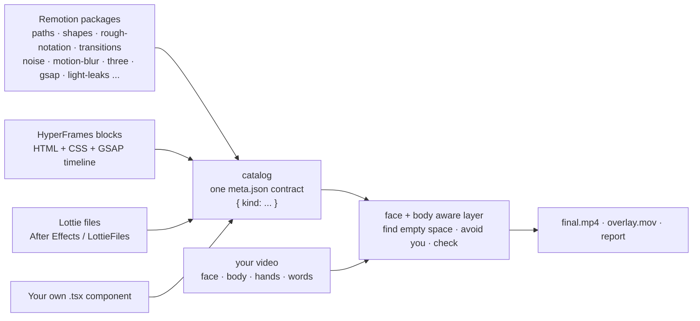

# connect-ai-video-motion

**Open source by CONNECT AI LAB · AI education for everyone.** A tool for one job: motion graphics on top of your own video.

```bash
npx connect-ai-video-motion demo
```

[](docs/index.html)

**[Open the catalog page](docs/index.html)**: all 57 graphics as living clips on real footage, filter by source, copy a prompt for your coding agent.

**Every motion graphic ecosystem, called with one line, placed around you.** Remotion packages, HyperFrames blocks, Lottie files and your own components all go through one layer that knows where your face, body and hands are, puts each graphic in good empty space, and checks its own work.



Like mixed martial arts took the best moves of every style and made them work together, this kit does not invent one more graphics library. It connects the ones that exist, so any of them is one line in `plan.json`:

```json
{"kind": "remotion/rough-highlight", "at": {"text": "free", "near": 2.0}, "text": "Free"}
{"kind": "hyperframes/split-words-rise", "at": 7.6, "text": "More colorful"}
{"kind": "lottie/gold-check", "at": 9.9}
{"kind": "custom", "component": "./my/Thing.tsx", "at": 4.2, "text": "Mine"}
```

**It never changes a pixel of you.** By default every graphic avoids your face, your body and your hands (measured 15 times a second) and goes where there is room. Graphics that follow a hand or stand behind you exist too, but they are a few options in the catalog, not the default.

> **Licences.** This kit is MIT. It runs on [Remotion](https://www.remotion.dev), which is not MIT: Remotion is free for individuals, companies with up to 3 employees and non-profits; other companies need a Remotion Company License ([LICENSE.md](https://github.com/remotion-dev/remotion/blob/main/LICENSE.md)). Some catalog items use Remotion packages under the same Remotion License, HyperFrames blocks are Apache-2.0, GSAP uses GreenSock's standard no-charge license. Each item says its licence in its `meta.json`; the full list is in [NOTICE.md](NOTICE.md).

The clip above and every clip on the [catalog page](docs/index.html) is the author's own footage (four rooms, four kinds of light), shown with his permission. Each graphic is one line of `plan.json`; the words on screen are words he said in that clip (Korean, shown in English). No box was drawn by hand around his hands: the body detector found them.

## See it

| | File | What to look at |
|---|---|---|
| Catalog page | [docs/index.html](docs/index.html) | 57 graphics, one living clip each, with its `kind`, licence and a prompt to copy |
| Montage | [docs/hero.mp4](docs/hero.mp4) | eleven of them, one per beat |
| Sheet | [docs/sheet.jpg](docs/sheet.jpg) | one still per graphic at its peak |
| Body | [docs/body_sheet.jpg](docs/body_sheet.jpg) | what the body detector sees: person area, joints, hands, finger count |

## Try it

You need Node.js 18 or newer. No Python. The ffmpeg inside Remotion is used.

```bash
git clone https://github.com/wonseokjung/connect-ai-video-motion.git
cd connect-ai-video-motion
npm install
npx connect-ai-video-motion demo           # built-in sample, start to finish
npx connect-ai-video-motion catalog        # every graphic you can call, by source
npx connect-ai-video-motion gallery vm-demo --sheet
```

Your own video: `npx connect-ai-video-motion my-talk.mp4`, or with a coding agent (Claude Code, Codex, Antigravity): `npx connect-ai-video-motion install-skill`, then ask it to "put motion graphics on my video".

## How it places things

1. **Face.** macOS Vision on a Mac. On other computers you or your agent write the face box from `face-sheet.jpg`.
2. **Body and hands.** macOS Vision finds the body joints (up to 19), 21 points per hand and the person area (a 64×36 grid), 15 times a second, plus a person matte where a graphic goes behind you. On Windows and Linux the same comes from MediaPipe (see below). Without either, the body is estimated from the face box, as in 0.1.
3. **Empty space.** The protected area is face + measured person (arms and hands too) + a margin, over the whole time a graphic is on screen. Named places beside you are tried first, then any free space. If you move so much that no place stays free, the graphic is cut in two halves that fade from one place to the next. If there is still no room, it is hidden and the report says why.
4. **Words.** `plan.json` is a table of "said word → graphic". A graphic lands 40 ms after its word (word times), or ±0.2 s with sentence subtitles.
5. **Check.** `check` writes every problem as a sentence: covers the face, covers the person (body, arms, hands, measured), lies on another graphic, outside the frame, more than 4 words, low contrast, a ray from your finger across your face or your body, a line around you that touches you, the same design twice.

## The catalog

`npx connect-ai-video-motion catalog` lists everything. Today: **57 graphics you can play** and 4 listed with the reason they cannot (yet).

| Source | Count | Examples |
|---|---|---|
| `kit/` | 7 | name tag, key word, counter, 1 · 2 · 3 steps, screen card, chapter, end card |
| `remotion/` | 35 | rough-notation box / highlight / strike / bracket list, paths journey / morph / signal / swoosh, shapes pie / bars / callout / star seal / hex badge, transitions clock wipe / iris / flip / slide / wipe / push cut, noise jitter / contour map, motion-blur trail, starburst rays, light leak behind you, 3D hex badge (svg-3d-engine), 3D gold coin (three), GSAP letters, macOS cursor click, words lit in time (captions) |
| `hyperframes/` | 7 | warm-grain circle stat, pill stat, shape label, title card; scramble title, words rise, ring counter (our blocks in the HyperFrames format) |
| `lottie/` | 3 | check mark, signal pulse, orbit arcs |
| `body/` | 5 | word behind you, line around you, tag on the hand, finger count stamp, ray from your finger |

Each item is a folder `catalog/<source>/<name>/` with the component (or `block.html` / `anim.json`) and a `meta.json`:

```json
{
  "kind": "remotion/shapes-pie",
  "title": "Pie to a percent",
  "description": "A pie fills to the percent you said, the number counts with it.",
  "source": {"type": "remotion", "package": "@remotion/shapes", "version": "4.0.529"},
  "license": "MIT",
  "use": "number",
  "props": {"value": "percent 0-100", "text": "what it is (1-3 words)"},
  "place": "box",
  "size": {"aspect": 2.2, "minW": 0.22, "maxW": 0.34},
  "dur": 2.8,
  "family": "pie"
}
```

A plan line can also carry `"scale": 1.3` (this graphic 30 % bigger; it still steps down if you leave no room), `"slot": "beside-right"` (try this side first), `"behind": true` or `"head"` (type drawn big behind you, under the person matte: the words are split at a word boundary and set on both sides of you, so your head never eats the letters; `check` fails if you cover more than 25 % of them), `"side": "minutes"` (one plain word on the other side of you, level with the graphic: number on the left, word on the right) and, for `kit/keyword`, a line break in the text (`"Visual\nVibe Coding"`) to stack the words with the last line in gold. `my-info.json` `"style"` picks the look: `connect` (black × gold, default), `day` (the same look for bright rooms: dark ink), `night`, `clean`.

`place` says how the layer treats it: `box` (empty space beside you), `attach` (`hand`, `fingers`, `point`, `contour`: follows your body, hidden while the hand is not seen clearly), `behind` (behind you, drawn under the person matte), `edge`, `post`, `full`. `family` is the design: the same family twice in one video gets a warning.

### Your own graphics

| You have | One line in plan.json |
|---|---|
| a Remotion component | `{"kind": "custom", "component": "./my/Thing.tsx", "at": 4.2, "meta": {"size": {"aspect": 2, "maxW": 0.3}}}` |
| a HyperFrames block | `{"kind": "hyperframes", "src": "./block.html", "at": 6, "meta": {"window": [0, 3], "text": {".title": "text"}}, "text": "Hello"}` |
| a Lottie file | `{"kind": "lottie", "src": "./anim.json", "at": 8}` |

A component gets `{it, r, lf, dur, st, ink, u, fps, L, mainF}`: the plan line, its box `[x, y, w, h]`, the frame inside the graphic, and more (see `src/catalog/ui.tsx`). It must stay inside `r`.

### HyperFrames

The adapter runs a block (HTML + CSS + a paused GSAP timeline in `window.__timelines`) in its own transparent iframe and seeks it to every Remotion frame. GSAP and its plugins come from the installed `gsap` package, never a CDN. `Math.random` is seeded and CSS animations are held at the frame time, so every render gives the same picture. `meta.window` picks seconds of the block's timeline, `meta.crop` a part of its canvas, `meta.text` puts your words in.

```bash
npx connect-ai-video-motion hf-import <folder>   # a registry checkout, a template, or your .html files
```

Each block is checked: WebGL / canvas, its own video or audio, a `requestAnimationFrame` loop, scripts from the internet, template placeholders and missing timelines are listed as `unsupported` with the reason.

## Body on Windows and Linux

The macOS detector needs nothing extra. On other computers the MediaPipe adapter (`lib/adapters/mediapipe-body.mjs`) runs MediaPipe Pose + Hands inside Remotion's own Chrome. It needs three things that are not installed with the kit (Apache-2.0, by Google):

| What | Where it goes |
|---|---|
| `npm install @mediapipe/tasks-vision` | `node_modules/` |
| `pose_landmarker_lite.task` | `models/mediapipe/` |
| `hand_landmarker.task` | `models/mediapipe/` |

Links are at the top of `lib/adapters/mediapipe-body.mjs`. With them, `analyze` uses MediaPipe automatically; without them it says which file is missing. It makes no person matte, so graphics that go behind you stay hidden there. This adapter follows the documented tasks-vision API and is not yet tested on Windows; please open an issue with what you see.

## Outputs

`out/final.mp4` · `out/short_9x16.mp4` (`--short`) · `out/overlay.mov` (`--overlay`, ProRes 4444 with alpha, for Premiere / CapCut / DaVinci) · `out/sheet.jpg` (enter / peak / exit of every graphic with the measured person drawn) · `out/report.md` · `out/gallery.mp4` and `out/gallery_sheet.jpg` (`gallery`) · `out/body-sheet.jpg` (`body-sheet`).

## Not yet

The full HyperFrames registry (456 items) is not in the package: download it and run `hf-import`. The shader transitions of `@remotion/transitions` (book flip, crosswarp, ripple ...) need the experimental HTML-in-canvas browser feature and are listed as unsupported. Sound effects and automatic word times (whisper) are not in this version.

## Credits

Built from open-source parts, each listed with package, version and licence in [NOTICE.md](NOTICE.md). The sample footage in the npm package is a drawn stand-in with a synthetic voice. The clips in `docs/` show the author, with his permission; they were made with `tools/make-showcase.mjs` and `tools/make-docs.mjs`.

MIT · CONNECT AI LAB
