# connect-ai-video-motion

**Open source by CONNECT AI LAB · AI education for everyone.** A tool for one job: motion graphics on top of your own video.

```bash
npx github:wonseokjung/connect-ai-video-motion demo
```


[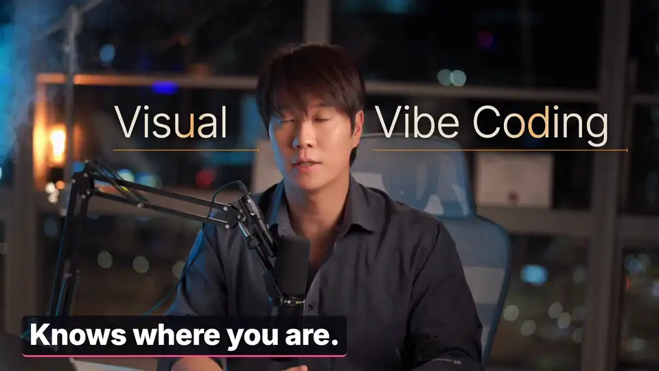](docs/index.html)

**[Open the catalog page](docs/index.html)**: all 66 graphics as living clips on real footage, filter by source, copy a prompt for your coding agent.

**Every motion graphic ecosystem, called with one line, placed around you.** Remotion packages, HyperFrames blocks, Lottie files and your own components all go through one layer that knows where your face, body and hands are, puts each graphic in good empty space, and checks its own work.

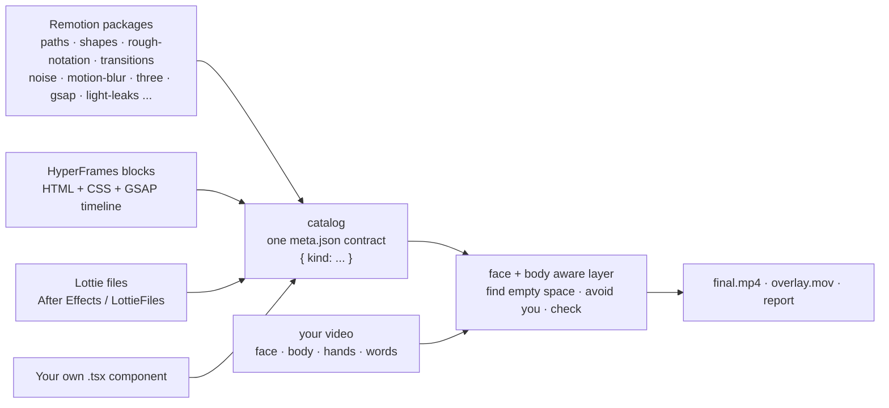

Like mixed martial arts took the best moves of every style and made them work together, this kit does not invent one more graphics library. It connects the ones that exist, so any of them is one line in `plan.json`:

```json
{"kind": "remotion/rough-highlight", "at": {"text": "free", "near": 2.0}, "text": "Free"}
{"kind": "hyperframes/split-words-rise", "at": 7.6, "text": "More colorful"}
{"kind": "lottie/gold-check", "at": 9.9}
{"kind": "custom", "component": "./my/Thing.tsx", "at": 4.2, "text": "Mine"}
```

**It never changes a pixel of you.** By default every graphic avoids your face, your body and your hands (measured 15 times a second) and goes where there is room. Graphics that follow a hand or stand behind you exist too, but they are a few options in the catalog, not the default.

> **Licences.** This kit is MIT. It runs on [Remotion](https://www.remotion.dev), which is not MIT: Remotion is free for individuals, companies with up to 3 employees and non-profits; other companies need a Remotion Company License ([LICENSE.md](https://github.com/remotion-dev/remotion/blob/main/LICENSE.md)). Some catalog items use Remotion packages under the same Remotion License, HyperFrames blocks are Apache-2.0, GSAP uses GreenSock's standard no-charge license. Each item says its licence in its `meta.json`; the full list is in [NOTICE.md](NOTICE.md).

The clip above and every clip on the [catalog page](docs/index.html) is the author's own footage (four rooms, four kinds of light), shown with his permission. Each graphic is one line of `plan.json`; the words on screen are words he said in that clip (Korean, shown in English). No box was drawn by hand around his hands: the body detector found them.


<!-- gallery:start -->
## Gallery: 66 graphics, one line of plan.json each

Everything below was made with this kit, on the author's own footage (AI Mentor Jay, shown with his permission). The words on screen are words he said in that clip. Not one face pixel was changed. Under each clip: the exact plan.json line that made it.

<p align="center"><br><sub>Before and after. The same frames: plain, then with one plan.json line. The words stand behind him (person matte in front).</sub></p>

<p align="center"><br><sub>The same graphic. Left: pinned to one spot (cut off by the frame). Right: placed by the face.</sub></p>

### Body aware · 22

Graphics that know where your body and hands are: they follow a hand, count fingers, stand behind you, draw in the air, ride your shoulder, read your own body as live data. The person matte keeps you, your microphone and your desk in front.

<table>
<tr><td width="33%" valign="top"><br><b>Afterimages of your motion</b><br><code>{&quot;kind&quot;: &quot;body/afterimage&quot;}</code></td><td width="33%" valign="top">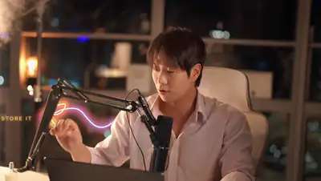<br><b>Write in the air</b><br><code>{&quot;kind&quot;: &quot;body/air-draw&quot;, &quot;text&quot;: &quot;Store it&quot;}</code></td><td width="33%" valign="top"><br><b>Aura around you</b><br><code>{&quot;kind&quot;: &quot;body/aura&quot;}</code></td></tr>
<tr><td width="33%" valign="top"><br><b>Count on the beat</b><br><code>{&quot;kind&quot;: &quot;body/beat-count&quot;, &quot;text&quot;: &quot;Right, Service, Right, Price&quot;}</code></td><td width="33%" valign="top"><br><b>Word behind you</b><br><code>{&quot;kind&quot;: &quot;body/behind-text&quot;, &quot;text&quot;: &quot;Open source&quot;, &quot;behind&quot;: true}</code></td><td width="33%" valign="top"><br><b>Line around you</b><br><code>{&quot;kind&quot;: &quot;body/contour-line&quot;, &quot;text&quot;: &quot;filmed like this&quot;}</code></td></tr>
<tr><td width="33%" valign="top"><br><b>Finger count stamp</b><br><code>{&quot;kind&quot;: &quot;body/finger-count&quot;, &quot;text&quot;: &quot;One, Two, Three, Four, Five&quot;}</code></td><td width="33%" valign="top"><br><b>Card in your hand</b><br><code>{&quot;kind&quot;: &quot;body/grab-card&quot;, &quot;text&quot;: &quot;Touch it&quot;, &quot;sub&quot;: &quot;you&quot;}</code></td><td width="33%" valign="top"><br><b>Words circling your head</b><br><code>{&quot;kind&quot;: &quot;body/halo-words&quot;, &quot;text&quot;: &quot;Connect AI Lab&quot;}</code></td></tr>
<tr><td width="33%" valign="top">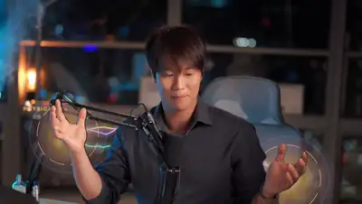<br><b>Energy between your hands</b><br><code>{&quot;kind&quot;: &quot;body/hand-arc&quot;, &quot;text&quot;: &quot;Physical&quot;}</code></td><td width="33%" valign="top">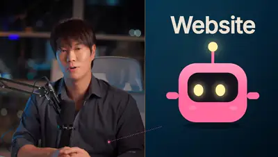<br><b>Robot on your hand</b><br><code>{&quot;kind&quot;: &quot;body/hand-buddy&quot;, &quot;text&quot;: &quot;Games&quot;}</code></td><td width="33%" valign="top">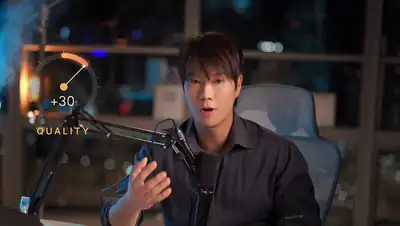<br><b>Dial you turn by hand</b><br><code>{&quot;kind&quot;: &quot;body/hand-dial&quot;, &quot;text&quot;: &quot;Quality&quot;}</code></td></tr>
<tr><td width="33%" valign="top">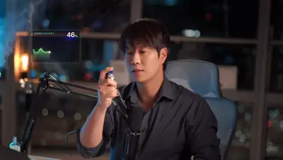<br><b>Chart your hand draws</b><br><code>{&quot;kind&quot;: &quot;body/hand-rise-chart&quot;, &quot;text&quot;: &quot;Hand height&quot;}</code></td><td width="33%" valign="top"><br><b>Tag on the hand</b><br><code>{&quot;kind&quot;: &quot;body/hand-tag&quot;, &quot;text&quot;: &quot;Colorful&quot;, &quot;sub&quot;: &quot;more&quot;}</code></td><td width="33%" valign="top"><br><b>Hologram from your hand</b><br><code>{&quot;kind&quot;: &quot;body/palm-hologram&quot;, &quot;text&quot;: &quot;3D&quot;}</code></td></tr>
<tr><td width="33%" valign="top"><br><b>Object passes behind you</b><br><code>{&quot;kind&quot;: &quot;body/pass-behind&quot;, &quot;text&quot;: &quot;AI native&quot;}</code></td><td width="33%" valign="top"><br><b>Ray from your finger</b><br><code>{&quot;kind&quot;: &quot;body/point-ray&quot;, &quot;text&quot;: &quot;Healthy food&quot;, &quot;sub&quot;: &quot;habit&quot;}</code></td><td width="33%" valign="top"><br><b>Spotlight where you point</b><br><code>{&quot;kind&quot;: &quot;body/point-spot&quot;, &quot;text&quot;: &quot;Interaction&quot;}</code></td></tr>
<tr><td width="33%" valign="top"><br><b>Room turns into data</b><br><code>{&quot;kind&quot;: &quot;body/room-to-data&quot;, &quot;text&quot;: &quot;Analyze&quot;}</code></td><td width="33%" valign="top"><br><b>Robot behind your shoulder</b><br><code>{&quot;kind&quot;: &quot;body/shoulder-buddy&quot;, &quot;text&quot;: &quot;All of it&quot;}</code></td><td width="33%" valign="top"><br><b>Body data beside your shoulder</b><br><code>{&quot;kind&quot;: &quot;body/shoulder-hud&quot;, &quot;text&quot;: &quot;AI agent&quot;}</code></td></tr>
<tr><td width="33%" valign="top"><br><b>Card that makes way</b><br><code>{&quot;kind&quot;: &quot;body/yield-card&quot;, &quot;text&quot;: &quot;Every day&quot;, &quot;sub&quot;: &quot;like this&quot;}</code></td></tr>
</table>

### Remotion · 39

Official Remotion packages: paths, shapes, noise, three.js, GSAP, transitions, light leaks, characters and math drawn in code.

<table>
<tr><td width="33%" valign="top"><br><b>Chip to card</b><br><code>{&quot;kind&quot;: &quot;remotion/animation-utils-chip&quot;, &quot;text&quot;: &quot;For beginners&quot;}</code></td><td width="33%" valign="top"><br><b>Words lit in time</b><br><code>{&quot;kind&quot;: &quot;remotion/captions-karaoke&quot;, &quot;text&quot;: &quot;Define, solve&quot;}</code></td><td width="33%" valign="top"><br><b>Letters fold up (GSAP)</b><br><code>{&quot;kind&quot;: &quot;remotion/gsap-letters&quot;, &quot;text&quot;: &quot;CONNECT AI LAB&quot;, &quot;behind&quot;: &quot;head&quot;}</code></td></tr>
<tr><td width="33%" valign="top"><br><b>Fit-to-space word</b><br><code>{&quot;kind&quot;: &quot;remotion/layout-fit-word&quot;, &quot;text&quot;: &quot;FREE&quot;}</code></td><td width="33%" valign="top"><br><b>Light leak behind you</b><br><code>{&quot;kind&quot;: &quot;remotion/light-leaks-glow&quot;}</code></td><td width="33%" valign="top"><br><b>Cursor clicks a button</b><br><code>{&quot;kind&quot;: &quot;remotion/mac-cursor-click&quot;, &quot;text&quot;: &quot;Click&quot;, &quot;sub&quot;: &quot;click&quot;}</code></td></tr>
<tr><td width="33%" valign="top"><br><b>Fast word with trail</b><br><code>{&quot;kind&quot;: &quot;remotion/motion-blur-trail&quot;, &quot;text&quot;: &quot;Like a movie&quot;, &quot;behind&quot;: &quot;head&quot;}</code></td><td width="33%" valign="top">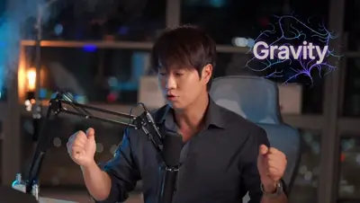<br><b>Flow field lines</b><br><code>{&quot;kind&quot;: &quot;remotion/noise-flow-field&quot;, &quot;text&quot;: &quot;Gravity&quot;}</code></td><td width="33%" valign="top"><br><b>Jitter to clean word</b><br><code>{&quot;kind&quot;: &quot;remotion/noise-jitter-word&quot;, &quot;text&quot;: &quot;Testing&quot;}</code></td></tr>
<tr><td width="33%" valign="top"><br><b>Contour map label</b><br><code>{&quot;kind&quot;: &quot;remotion/noise-topo-label&quot;, &quot;text&quot;: &quot;Physical&quot;, &quot;sub&quot;: &quot;this world&quot;}</code></td><td width="33%" valign="top"><br><b>Square brackets</b><br><code>{&quot;kind&quot;: &quot;remotion/paths-brackets&quot;, &quot;text&quot;: &quot;Solve it&quot;}</code></td><td width="33%" valign="top"><br><b>Curve draws itself</b><br><code>{&quot;kind&quot;: &quot;remotion/paths-equation-graph&quot;, &quot;text&quot;: &quot;Performance&quot;, &quot;curve&quot;: &quot;rise&quot;}</code></td></tr>
<tr><td width="33%" valign="top">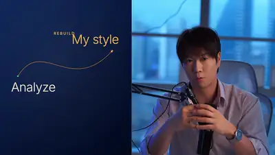<br><b>Journey A to B</b><br><code>{&quot;kind&quot;: &quot;remotion/paths-journey&quot;, &quot;text&quot;: &quot;Analyze&quot;, &quot;label&quot;: &quot;rebuild&quot;}</code></td><td width="33%" valign="top"><br><b>Shape morph, before to after</b><br><code>{&quot;kind&quot;: &quot;remotion/paths-morph&quot;, &quot;text&quot;: &quot;Engineering&quot;, &quot;sub&quot;: &quot;Business&quot;}</code></td><td width="33%" valign="top"><br><b>Signal wave</b><br><code>{&quot;kind&quot;: &quot;remotion/paths-signal&quot;, &quot;text&quot;: &quot;Precise&quot;, &quot;sub&quot;: &quot;as told&quot;}</code></td></tr>
<tr><td width="33%" valign="top"><br><b>Spirograph draws itself</b><br><code>{&quot;kind&quot;: &quot;remotion/paths-spirograph&quot;, &quot;text&quot;: &quot;One&quot;}</code></td><td width="33%" valign="top">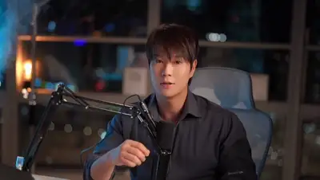<br><b>Swoosh underline</b><br><code>{&quot;kind&quot;: &quot;remotion/paths-swoosh&quot;, &quot;text&quot;: &quot;Quality&quot;}</code></td><td width="33%" valign="top">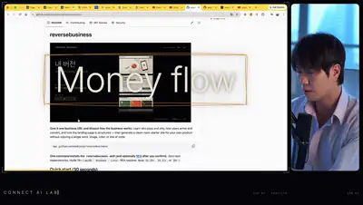<br><b>Pen box</b><br><code>{&quot;kind&quot;: &quot;remotion/rough-box&quot;, &quot;text&quot;: &quot;Code it&quot;}</code></td></tr>
<tr><td width="33%" valign="top"><br><b>Bracket list</b><br><code>{&quot;kind&quot;: &quot;remotion/rough-bracket-list&quot;, &quot;text&quot;: &quot;English, Japanese, German&quot;}</code></td><td width="33%" valign="top"><br><b>Highlighter</b><br><code>{&quot;kind&quot;: &quot;remotion/rough-highlight&quot;, &quot;text&quot;: &quot;Autonomous&quot;}</code></td><td width="33%" valign="top"><br><b>Strike out</b><br><code>{&quot;kind&quot;: &quot;remotion/rough-strike&quot;, &quot;text&quot;: &quot;Just tools&quot;, &quot;sub&quot;: &quot;The flow&quot;}</code></td></tr>
<tr><td width="33%" valign="top"><br><b>Message bubble</b><br><code>{&quot;kind&quot;: &quot;remotion/rounded-message&quot;, &quot;text&quot;: &quot;HyperFrames or Remotion?&quot;}</code></td><td width="33%" valign="top">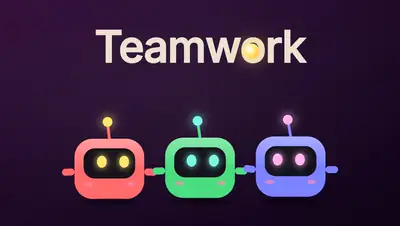<br><b>Agent robots pass the ball</b><br><code>{&quot;kind&quot;: &quot;remotion/shapes-agents&quot;, &quot;text&quot;: &quot;Teamwork&quot;}</code></td><td width="33%" valign="top"><br><b>Arrow with a word</b><br><code>{&quot;kind&quot;: &quot;remotion/shapes-arrow&quot;, &quot;text&quot;: &quot;Right target&quot;}</code></td></tr>
<tr><td width="33%" valign="top"><br><b>Rising bars</b><br><code>{&quot;kind&quot;: &quot;remotion/shapes-bars&quot;, &quot;value&quot;: &quot;2, 3, 10&quot;}</code></td><td width="33%" valign="top"><br><b>Speech callout</b><br><code>{&quot;kind&quot;: &quot;remotion/shapes-callout&quot;, &quot;text&quot;: &quot;Know both&quot;}</code></td><td width="33%" valign="top"><br><b>Pie to a percent</b><br><code>{&quot;kind&quot;: &quot;remotion/shapes-pie&quot;, &quot;value&quot;: &quot;100&quot;}</code></td></tr>
<tr><td width="33%" valign="top"><br><b>Hexagon badge</b><br><code>{&quot;kind&quot;: &quot;remotion/shapes-polygon-badge&quot;, &quot;text&quot;: &quot;Any format&quot;}</code></td><td width="33%" valign="top"><br><b>Star seal</b><br><code>{&quot;kind&quot;: &quot;remotion/shapes-star-seal&quot;, &quot;value&quot;: &quot;20&quot;}</code></td><td width="33%" valign="top"><br><b>Triangle marker</b><br><code>{&quot;kind&quot;: &quot;remotion/shapes-triangle-marker&quot;, &quot;text&quot;: &quot;Before we start&quot;, &quot;sub&quot;: &quot;practice&quot;}</code></td></tr>
<tr><td width="33%" valign="top">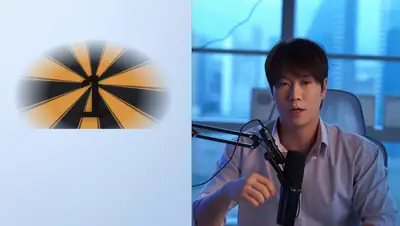<br><b>Rays behind a number</b><br><code>{&quot;kind&quot;: &quot;remotion/starburst-rays&quot;, &quot;value&quot;: &quot;1&quot;}</code></td><td width="33%" valign="top"><br><b>3D hex badge</b><br><code>{&quot;kind&quot;: &quot;remotion/svg3d-badge&quot;, &quot;text&quot;: &quot;3D&quot;}</code></td><td width="33%" valign="top"><br><b>3D gold coin</b><br><code>{&quot;kind&quot;: &quot;remotion/three-coin&quot;, &quot;value&quot;: &quot;66&quot;}</code></td></tr>
<tr><td width="33%" valign="top"><br><b>Clock wipe, before to after</b><br><code>{&quot;kind&quot;: &quot;remotion/transition-clock-wipe&quot;}</code></td><td width="33%" valign="top"><br><b>Card flip, before to after</b><br><code>{&quot;kind&quot;: &quot;remotion/transition-flip&quot;}</code></td><td width="33%" valign="top"><br><b>Iris, before to after</b><br><code>{&quot;kind&quot;: &quot;remotion/transition-iris&quot;}</code></td></tr>
<tr><td width="33%" valign="top">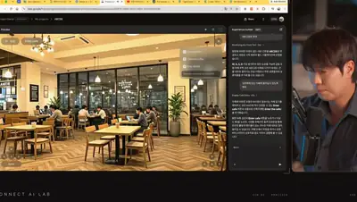<br><b>Push cut with flash, before to after</b><br><code>{&quot;kind&quot;: &quot;remotion/transition-push-cut&quot;}</code></td><td width="33%" valign="top"><br><b>Push slide, before to after</b><br><code>{&quot;kind&quot;: &quot;remotion/transition-slide&quot;}</code></td><td width="33%" valign="top"><br><b>Diagonal wipe, before to after</b><br><code>{&quot;kind&quot;: &quot;remotion/transition-wipe&quot;}</code></td></tr>
</table>

### HyperFrames · 8

HTML + CSS + GSAP blocks.

<table>
<tr><td width="33%" valign="top">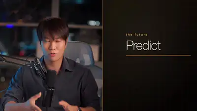<br><b>Scramble title (GSAP)</b><br><code>{&quot;kind&quot;: &quot;hyperframes/gold-scramble-title&quot;, &quot;text&quot;: &quot;Motion&quot;, &quot;sub&quot;: &quot;graphics&quot;}</code></td><td width="33%" valign="top"><br><b>Neon word stack (GSAP)</b><br><code>{&quot;kind&quot;: &quot;hyperframes/neon-stack&quot;, &quot;text&quot;: &quot;Tried&quot;, &quot;label&quot;: &quot;Succeeded&quot;}</code></td><td width="33%" valign="top"><br><b>Ring counter (GSAP)</b><br><code>{&quot;kind&quot;: &quot;hyperframes/ring-count&quot;, &quot;value&quot;: &quot;8&quot;}</code></td></tr>
<tr><td width="33%" valign="top"><br><b>Words rise (GSAP SplitText)</b><br><code>{&quot;kind&quot;: &quot;hyperframes/split-words-rise&quot;, &quot;text&quot;: &quot;My AI agents&quot;}</code></td><td width="33%" valign="top">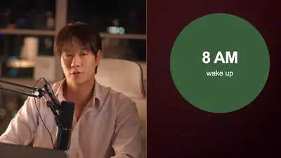<br><b>Circle stat (HyperFrames)</b><br><code>{&quot;kind&quot;: &quot;hyperframes/warm-grain-circle-stat&quot;, &quot;text&quot;: &quot;wake up&quot;, &quot;value&quot;: &quot;8 AM&quot;}</code></td><td width="33%" valign="top"><br><b>Pill stat (HyperFrames)</b><br><code>{&quot;kind&quot;: &quot;hyperframes/warm-grain-pill-stat&quot;, &quot;value&quot;: &quot;Opportunity&quot;}</code></td></tr>
<tr><td width="33%" valign="top"><br><b>Shape label (HyperFrames)</b><br><code>{&quot;kind&quot;: &quot;hyperframes/warm-grain-shape-label&quot;, &quot;text&quot;: &quot;Mix them&quot;}</code></td><td width="33%" valign="top">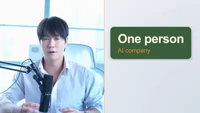<br><b>Title card (HyperFrames)</b><br><code>{&quot;kind&quot;: &quot;hyperframes/warm-grain-title-card&quot;, &quot;text&quot;: &quot;AI education&quot;, &quot;sub&quot;: &quot;for everyone&quot;}</code></td></tr>
</table>

### Lottie · 4

After Effects / LottieFiles animations, characters too.

<table>
<tr><td width="33%" valign="top"><br><b>Orbit arcs (Lottie)</b><br><code>{&quot;kind&quot;: &quot;lottie/arc-orbit&quot;}</code></td><td width="33%" valign="top"><br><b>Check mark (Lottie)</b><br><code>{&quot;kind&quot;: &quot;lottie/gold-check&quot;}</code></td><td width="33%" valign="top"><br><b>Hopping character (Lottie)</b><br><code>{&quot;kind&quot;: &quot;lottie/hop-buddy&quot;}</code></td></tr>
<tr><td width="33%" valign="top">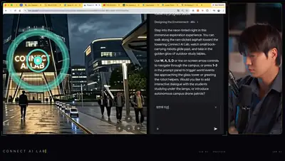<br><b>Signal pulse (Lottie)</b><br><code>{&quot;kind&quot;: &quot;lottie/signal-pulse&quot;}</code></td></tr>
</table>

### Kit · 7

The kit's own graphics.

<table>
<tr><td width="33%" valign="top">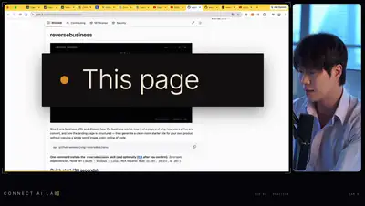<br><b>Screen card + arrow</b><br><code>{&quot;kind&quot;: &quot;kit/card&quot;, &quot;text&quot;: &quot;To-do list&quot;}</code></td><td width="33%" valign="top">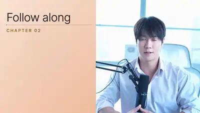<br><b>Chapter line</b><br><code>{&quot;kind&quot;: &quot;kit/chapter&quot;, &quot;text&quot;: &quot;Follow along&quot;, &quot;value&quot;: &quot;02&quot;}</code></td><td width="33%" valign="top">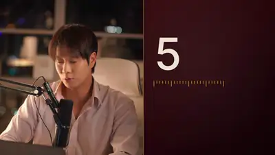<br><b>Number counter</b><br><code>{&quot;kind&quot;: &quot;kit/counter&quot;, &quot;value&quot;: &quot;5&quot;}</code></td></tr>
<tr><td width="33%" valign="top">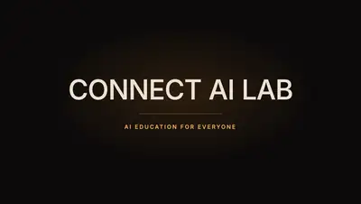<br><b>End card</b><br><code>{&quot;kind&quot;: &quot;kit/endcard&quot;, &quot;text&quot;: &quot;CONNECT AI LAB&quot;, &quot;sub&quot;: &quot;AI education for everyone&quot;}</code></td><td width="33%" valign="top">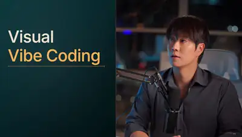<br><b>Key word</b><br><code>{&quot;kind&quot;: &quot;kit/keyword&quot;, &quot;text&quot;: &quot;Visual Vibe Coding&quot;, &quot;behind&quot;: &quot;head&quot;}</code></td><td width="33%" valign="top"><br><b>Name tag</b><br><code>{&quot;kind&quot;: &quot;kit/nametag&quot;, &quot;text&quot;: &quot;AI Mentor Jay&quot;, &quot;sub&quot;: &quot;CONNECT AI LAB&quot;}</code></td></tr>
<tr><td width="33%" valign="top"><br><b>1 · 2 · 3 steps</b><br><code>{&quot;kind&quot;: &quot;kit/steps&quot;, &quot;text&quot;: &quot;Film&quot;, &quot;value&quot;: &quot;1&quot;}</code></td></tr>
</table>

<!-- gallery:end -->

## See it

| | File | What to look at |
|---|---|---|
| Catalog page | [docs/index.html](docs/index.html) | 66 graphics, one living clip each, with its `kind`, licence and a prompt to copy |
| Reel | [docs/hero_v2.mp4](docs/hero_v2.mp4) | the reel at the top in 1920x1080 (with sound: [docs/hero_v2_social.mp4](docs/hero_v2_social.mp4)) |
| Sheet | [docs/sheet.jpg](docs/sheet.jpg) | one still per graphic at its peak |
| Body | [docs/body_sheet.jpg](docs/body_sheet.jpg) | what the body detector sees: person area, joints, hands, finger count |

## Try it

You need Node.js 18 or newer. No Python. The ffmpeg inside Remotion is used.

```bash
git clone https://github.com/wonseokjung/connect-ai-video-motion.git
cd connect-ai-video-motion
npm install
npx github:wonseokjung/connect-ai-video-motion demo           # built-in sample, start to finish
npx github:wonseokjung/connect-ai-video-motion catalog        # every graphic you can call, by source
npx github:wonseokjung/connect-ai-video-motion gallery vm-demo --sheet
```

Your own video: `npx github:wonseokjung/connect-ai-video-motion my-talk.mp4`, or with a coding agent (Claude Code, Codex, Antigravity): `npx github:wonseokjung/connect-ai-video-motion install-skill`, then ask it to "put motion graphics on my video".

## How it places things

1. **Face.** macOS Vision on a Mac. On Windows and Linux (or a Mac without Xcode tools) the MediaPipe face detector finds it automatically; it ships with the kit, nothing to download. If no face is found, you or your agent write the face box from `face-sheet.jpg`.
2. **Body and hands.** macOS Vision finds the body joints (up to 19), 21 points per hand and the person area (a 64×36 grid), 15 times a second, plus a person matte where a graphic goes behind you. On Windows and Linux the same comes from MediaPipe (see below). Without either, the body is estimated from the face box, as in 0.1.
3. **Empty space.** The protected area is face + measured person (arms and hands too) + a margin, over the whole time a graphic is on screen. Named places beside you are tried first, then any free space. If you move so much that no place stays free, the graphic is cut in two halves that fade from one place to the next. If there is still no room, it is hidden and the report says why.
4. **Words.** `plan.json` is a table of "said word → graphic". A graphic lands 40 ms after its word (word times), or ±0.2 s with sentence subtitles.
5. **Check.** `check` writes every problem as a sentence: covers the face, covers the person (body, arms, hands, measured), lies on another graphic, outside the frame, more than 4 words, low contrast, a ray from your finger across your face or your body, a line around you that touches you, the same design twice.

## The catalog

`npx github:wonseokjung/connect-ai-video-motion catalog` lists everything. Today: **66 graphics you can play** and 4 listed with the reason they cannot (yet).

| Source | Count | Examples |
|---|---|---|
| `kit/` | 7 | name tag, key word, counter, 1 · 2 · 3 steps, screen card, chapter, end card |
| `remotion/` | 39 | robot characters passing a ball (shapes + spring), a curve that draws itself, a spirograph, a noise flow field, rough-notation box / highlight / strike / bracket list, paths journey / morph / signal / swoosh, shapes pie / bars / callout / star seal / hex badge, transitions clock wipe / iris / flip / slide / wipe / push cut, noise jitter / contour map, motion-blur trail, starburst rays, light leak behind you, 3D hex badge (svg-3d-engine), 3D gold coin (three), GSAP letters, macOS cursor click, words lit in time (captions) |
| `hyperframes/` | 8 | warm-grain circle stat, pill stat, shape label, title card; scramble title, words rise, ring counter, neon word stack (our blocks in the HyperFrames format) |
| `lottie/` | 4 | hopping character, check mark, signal pulse, orbit arcs |
| `body/` | 8 | word behind you, line around you, tag on the hand, finger count stamp, ray from your finger, 3D hologram by your hand, robot that follows your hand, live chart of your hand's height |

Each item is a folder `catalog/<source>/<name>/` with the component (or `block.html` / `anim.json`) and a `meta.json`:

```json
{
  "kind": "remotion/shapes-pie",
  "title": "Pie to a percent",
  "description": "A pie fills to the percent you said, the number counts with it.",
  "source": {"type": "remotion", "package": "@remotion/shapes", "version": "4.0.529"},
  "license": "MIT",
  "use": "number",
  "props": {"value": "percent 0-100", "text": "what it is (1-3 words)"},
  "place": "box",
  "size": {"aspect": 2.2, "minW": 0.22, "maxW": 0.34},
  "dur": 2.8,
  "family": "pie"
}
```

A plan line can also carry `"scale": 1.3` (this graphic 30 % bigger; it still steps down if you leave no room), `"slot": "beside-right"` (try this side first), `"behind": true` or `"head"` (type drawn big behind you, under the person matte: the words are split at a word boundary and set on both sides of you, so your head never eats the letters; `check` fails if you cover more than 25 % of them), `"side": "minutes"` (one plain word on the other side of you, level with the graphic: number on the left, word on the right) and, for `kit/keyword`, a line break in the text (`"Visual\nVibe Coding"`) to stack the words with the last line in gold. `my-info.json` `"style"` picks the look: `connect` (black × gold, default), `day` (the same look for bright rooms: dark ink), `night`, `clean`.

`place` says how the layer treats it: `box` (empty space beside you), `attach` (`hand`, `fingers`, `point`, `contour`: follows your body, hidden while the hand is not seen clearly), `behind` (behind you, drawn under the person matte), `edge`, `post`, `full`. `family` is the design: the same family twice in one video gets a warning.

### Your own graphics

| You have | One line in plan.json |
|---|---|
| a Remotion component | `{"kind": "custom", "component": "./my/Thing.tsx", "at": 4.2, "meta": {"size": {"aspect": 2, "maxW": 0.3}}}` |
| a HyperFrames block | `{"kind": "hyperframes", "src": "./block.html", "at": 6, "meta": {"window": [0, 3], "text": {".title": "text"}}, "text": "Hello"}` |
| a Lottie file | `{"kind": "lottie", "src": "./anim.json", "at": 8}` |

A component gets `{it, r, lf, dur, st, ink, u, fps, L, mainF}`: the plan line, its box `[x, y, w, h]`, the frame inside the graphic, and more (see `src/catalog/ui.tsx`). It must stay inside `r`.

### HyperFrames

The adapter runs a block (HTML + CSS + a paused GSAP timeline in `window.__timelines`) in its own transparent iframe and seeks it to every Remotion frame. GSAP and its plugins come from the installed `gsap` package, never a CDN. `Math.random` is seeded and CSS animations are held at the frame time, so every render gives the same picture. `meta.window` picks seconds of the block's timeline, `meta.crop` a part of its canvas, `meta.text` puts your words in.

```bash
npx github:wonseokjung/connect-ai-video-motion hf-import <folder>   # a registry checkout, a template, or your .html files
```

Each block is checked: WebGL / canvas, its own video or audio, a `requestAnimationFrame` loop, scripts from the internet, template placeholders and missing timelines are listed as `unsupported` with the reason.

## Face and body on Windows and Linux

The face works out of the box on every computer: `@mediapipe/tasks-vision` is a dependency and the face model (`models/mediapipe/blaze_face_short_range.tflite`, 230 KB, Apache-2.0, by Google) ships with the kit. On our test clip (3840x2160, 23 looks) its head box was within a median 37 px of the macOS Vision box. Run with `VM_FACE=mediapipe` on a Mac to try it there. Add `--verbose` (or `VM_VERBOSE=1`) to print what the face probe sees, frame by frame.

The macOS body detector needs nothing extra. On other computers the MediaPipe adapter (`lib/adapters/mediapipe-body.mjs`) runs MediaPipe Pose + Hands inside Remotion's own Chrome. The package comes with the kit; the two body models do not (Apache-2.0, by Google):

| What | Where it goes |
|---|---|
| `pose_landmarker_lite.task` | `models/mediapipe/` |
| `hand_landmarker.task` | `models/mediapipe/` |

Links are at the top of `lib/adapters/mediapipe-body.mjs`. With them, `analyze` uses MediaPipe automatically; without them it says which file is missing. It makes no person matte, so graphics that go behind you stay hidden there. This adapter follows the documented tasks-vision API and is not yet tested on Windows; please open an issue with what you see.

## Outputs

`out/final.mp4` · `out/short_9x16.mp4` (`--short`) · `out/overlay.mov` (`--overlay`, ProRes 4444 with alpha, for Premiere / CapCut / DaVinci) · `out/sheet.jpg` (enter / peak / exit of every graphic with the measured person drawn) · `out/report.md` · `out/gallery.mp4` and `out/gallery_sheet.jpg` (`gallery`) · `out/body-sheet.jpg` (`body-sheet`).

## Not yet

The full HyperFrames registry (456 items) is not in the package: download it and run `hf-import`. The shader transitions of `@remotion/transitions` (book flip, crosswarp, ripple ...) need the experimental HTML-in-canvas browser feature and are listed as unsupported. Sound effects and automatic word times (whisper) are not in this version.

## Credits

Built from open-source parts, each listed with package, version and licence in [NOTICE.md](NOTICE.md). The sample footage in the npm package is a drawn stand-in with a synthetic voice. The clips in `docs/` show the author, with his permission; they were made with `tools/make-showcase.mjs` and `tools/make-docs.mjs`.

MIT · CONNECT AI LAB
